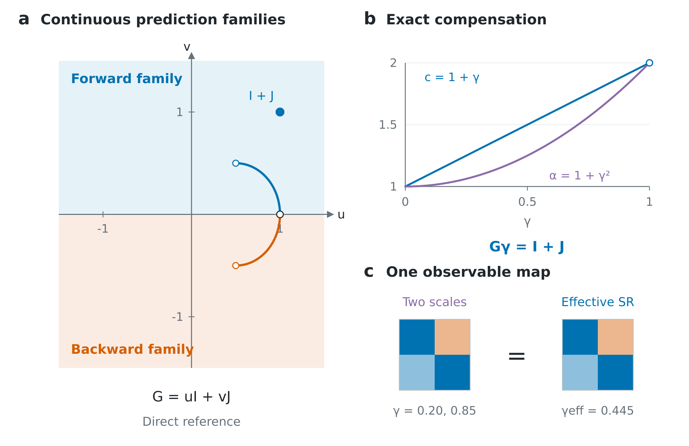

# Identifying direction and temporal weighting in predictive cognitive maps

Reproducibility materials for **Yongzhang Ji**, Faculty of Psychology, Southwest University, Chongqing, China. [ORCID](https://orcid.org/0009-0006-4111-2000). Release snapshot: v1.0.0, 26 November 2026.

## Overview

The paper examines which temporal properties are identifiable across continuous successor-representation (SR) families. It characterizes geometric and reference-induced equivalence, derives direction-exclusive regions under reciprocal tasks, and develops task-compatible readouts, joint-error inference and experimental routes to quantitative temporal weighting. Repeated neural measurements calibrate reference estimates and known transformations; these are not endogenous SR-direction or participant-level discount estimates.

[English manuscript](manuscripts/Manuscript_EN.pdf) · [English supplement](manuscripts/Supplementary_EN.pdf) · [Chinese manuscript](manuscripts/Manuscript_ZH.pdf) · [Chinese supplement](manuscripts/Supplementary_ZH.pdf)



## Quick start

Use Python 3.12. Install the archived package versions and run:

```bash
python -m venv .venv
# Linux/macOS: source .venv/bin/activate
# Windows PowerShell: .venv\Scripts\Activate.ps1
python -m pip install -r requirements.txt
python reproduce.py
```

The runner executes symbolic and deterministic checks, the cyclic-lag example, dFB condition-table verification and Figure 7 table reaggregation in a temporary copy. Logs and regenerated outputs are saved in `reproduction_runs/latest/`. No network access is needed once dependencies are installed. The source snapshot is not overwritten.

For the optional measured-array check, obtain a permitted copy of `fig07_empirical_arrays.npz` (see [data guide](source_data/README_DATA.md)) and run:

```bash
python reproduce.py --require-measured-input --measured-input /path/to/fig07_empirical_arrays.npz
```

This adds downstream reference refits and frozen-readout reconstruction. It does not rerun original EEG preprocessing. The optional check is explicitly skipped when its input is missing; its input hash is verified if provided.

## Repository map

| Path | Contents |
|---|---|
| `code/` | Theory, table and measured-input checks; manuscript and figure generation utilities |
| `math/theorem_registry.json` | Formal results T01–T28 |
| `supplement/` | Editable general proofs and empirical E1–E11 |
| `source_data/` | Analytic figure data, condition-level results, provenance and data instructions |
| `empirical/` | Audit outputs and source manifests |
| `figures/` | Eight bilingual figure sets, SVG/PDF/PNG and captions |
| `manuscripts/` | Reference manuscript snapshot and editable sources |
| `reference_archive/` | Historical analysis code and reports, requiring separately restored inputs for original fits |
| `validation/` | Original assembly/figure QA and repository verification |
| `literature/` | Bibliographic metadata |

## Reproduction targets

- `code/math_checks.py`, `code/math_additions.py`: exact/representative mathematical checks; general proofs are in the supplement.
- `code/empirical_check_cyclic_lag_coordinates.py`: finite-cycle coordinate counterexample.
- `code/empirical_check_dfb_tables.py`: verify the saved sufficient inequalities and counts among 864 imposed-direction conditions; this is a table audit, not a fresh neural-model fit.
- `code/check_fig07_tables.py`: reference prediction gains, conditional-positive rows, physical-block and cross-record abstentions, using archived source tables.
- `code/empirical_check_fig07_portable.py`: downstream measured-array checks, requiring the separately supplied permitted input.
- `reference_archive/analysis_code/README.md`: historical analysis entry points and source archive requirements. Large archives and raw data are not redistributed here.

See `source_data/redrawn_figure_captions.json` for the mapping between the current eight figures and tables/proof identifiers. Some source tables retain numbering from earlier editions.

## Rebuild figures and manuscripts (optional)

The PDFs and vector artwork are included. To rebuild in a working copy, install Inkscape, Pandoc, XeLaTeX, standard TeX packages, Noto Serif/Sans, Noto Serif/Sans CJK SC, DejaVu Sans and Latin Modern fonts. No font files are distributed.

```bash
python code/redraw_figures.py
python code/write_figure_captions.py
python code/assemble_manuscripts.py
python code/build_manuscripts.py
python code/verify_redrawn_figures.py
python code/verify_manuscripts.py
```

The document verifier uses logs generated by the build step. The paper is the 26 November reference snapshot; final correspondence, repository links and preprint metadata may be added before publication.

## Data, citation and licensing

[Data guide](source_data/README_DATA.md) · [16-branch source catalog](source_data/research_branch_catalog.csv) · [Citation](CITATION.cff) · [License scope](LICENSE_SCOPE.md)

The original neural recordings remain with their cited public sources. The code and result tables preserve the analysis units: known-transform conditions and regrouped repeats are not independent participants. The optional measured EEG array is not redistributed in this public directory. No DOI has yet been assigned to this release or preprint in this snapshot. After publication, update the citation and manuscript availability statement with the actual URLs/DOI.

Funding: none. Competing interests: none declared. Ethics and AI-assistance statements are in the manuscript. The MIT license covers original code only. See the license scope and data guide for the terms that apply to other materials.
