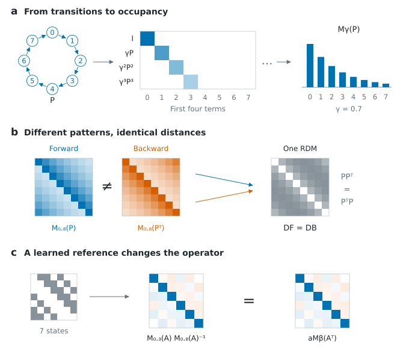
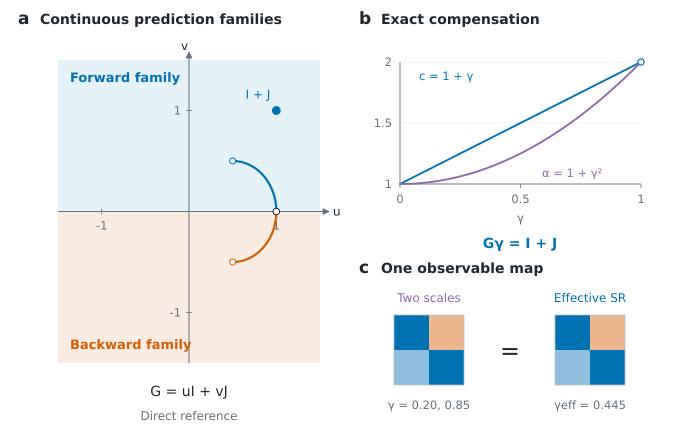
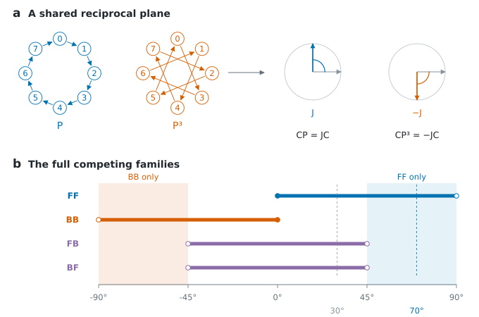
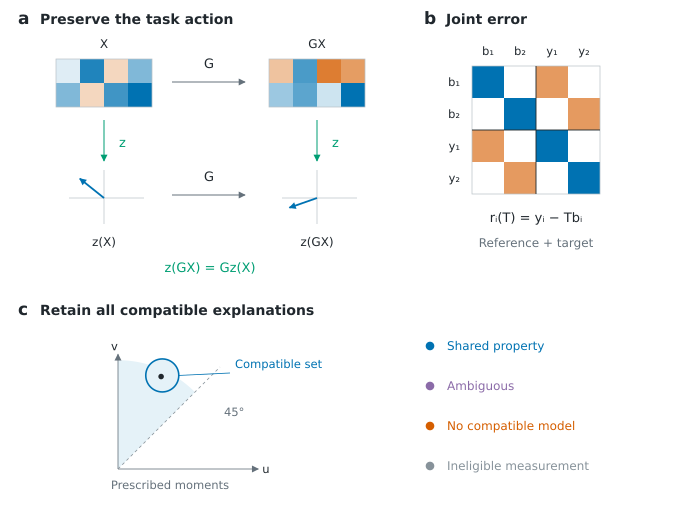
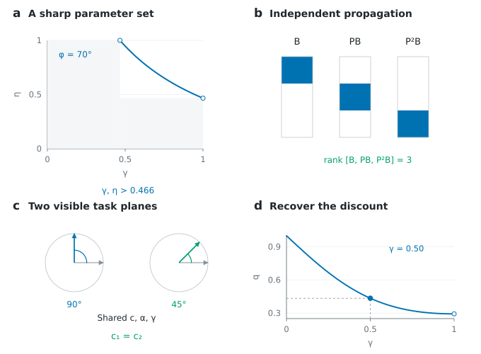
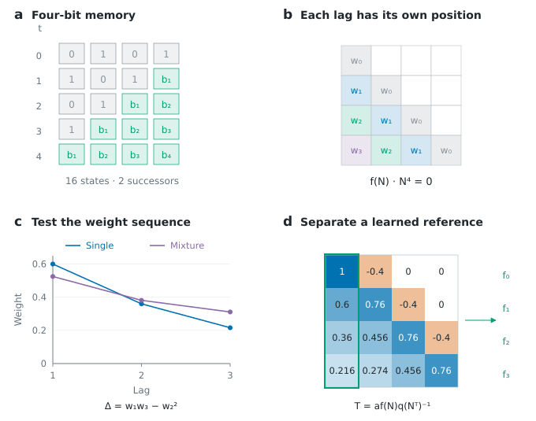
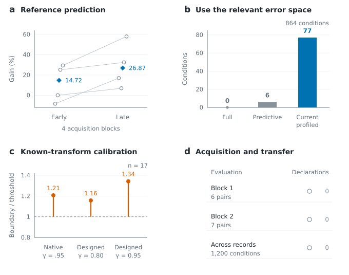
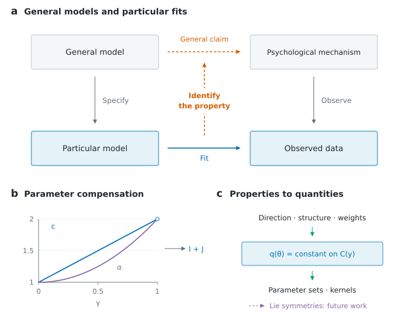

## Abstract

The successor representation (SR) describes a current state through discounted occupancy of future states. Interpreting neural data in these terms requires identifying both temporal direction and temporal weighting. We examine which properties are identifiable across continuous SR families. Opposite maps can have identical canonical Euclidean geometry, and a learned reference can make the complete state-contrast action between two forward representations equal a backward SR. Continuous-family analysis unifies these equivalences through the set of compatible explanations and reveals different information requirements for direction and parameters. On a directly referenced rotation plane, direction can be identified while any discount is compensated by current and predictive weights. Reciprocal tasks create direction-exclusive regions for complete SR and specified extensions; task-compatible readout preserves these relations; joint-error inversion supports finite-sample property declarations. Relative angles already give sharp discount ranges; additional independent propagation shapes identify unique parameter values or finite temporal kernels. A finite-memory design also supports tests of multiscale mixtures and recovery of a target kernel’s relative shape despite a learned reference. Calibration with public repeated neural measurements shows predictive gains for task-relevant references and more decidable known-transformation conditions with appropriate error spaces and readouts. Actual acquisition units determine how these decisions transfer. Together, the results provide a route from observational compatibility to mechanistic properties and quantitative constraints.

**Keywords:** successor representation; cognitive maps; identifiability; predictive direction; temporal weighting; continuous model families

## Introduction

At a familiar junction, the scene in front of us is only part of what we know. We know where we have just come from and what we might encounter along each route ahead. A cognitive map brings these relations into present behaviour: remembering the past helps identify a context, and anticipating the future helps plan an action. The two computations may use the same places or events. Their difference lies in how those states are organized around the present.

The successor representation provides a concrete model of the prospective relation [1]. It represents a current state as a weighted sum of the states that may be occupied after departing from it. Predictive-map theory connects this idea to hippocampal population activity and relates state transitions to representational similarity [2]. The programme has extended to abstract relations, predictive horizons across brain regions, sequence anticipation and changes in representation after learning [5–8,19]. These findings make a mechanistic question important: when neural activity contains future-related structure, what can we infer about how the system organizes time?

The question has two related parts. The first concerns direction: does the present representation contain states about to be encountered, states encountered recently, or a mixture? The second concerns weighting: how do different temporal distances contribute, and do they follow one geometric discount? Existing work offers several ways to distinguish these possibilities. The relation between temporal-context models and SR reveals equivalence under particular learning conditions [3]. Revaluation experiments use restrictions on newly available information to distinguish planning processes [4]. Base rates, graph structure and query demands can make forward and backward prediction produce different behavioural choices [9]. Multiscale representations and symmetric learning rules further expand the mechanisms available for investigation [10,11].

Neural measurement adds another relation to this problem. We usually record patterns that mix several sources, then compare distances between patterns or use reference measurements to read out their content. Work on representational models shows how feature bases, priors and measurement choices jointly specify empirical predictions [12–14]. Whether a mechanism can be identified therefore depends both on how it generates an internal representation and on which differences survive into the observation used by the researcher. For SR, the transition structure, temporal weights and learning history of the reference all contribute to that relation.

We follow this chain from model to observation. Two exact examples first show how opposite directions can coincide in distance geometry or in the relative action measured against a learned reference. We then examine the continuous predictions generated by all allowed parameters and ask whether every explanation compatible with an observation shares a property. This separates directional inference from parameter recovery: parameters may vary along a continuous curve while direction is already determined. Reciprocal tasks, task-compatible readout and joint uncertainty turn the principle into an operational inference. Further independent propagation information supports quantitative recovery of discounts and temporal kernels. Repeated neural measurements finally examine the reference, readout and acquisition requirements along this route.

## Results

### 1. Two mechanistic questions about predictive maps

#### 1.1 From state transitions to future occupancy

On a familiar journey from home to the office, we pass a junction and a station, perhaps stopping at a shop. At the junction, we know where we are. We also know which places are likely to occur next in our experience. The successor representation (SR) incorporates this second kind of knowledge into the representation of the current state. It asks: “Starting from here, what might I encounter in the future?”

Dayan introduced the SR in reinforcement learning in 1993, using relationships between successor states to organize representations for long-term reward prediction [1]. The model can be understood by beginning with one transition. Let $P_{ij}$ be the probability of reaching state $j$ on the next step when the current state is $i$. Each row of the transition matrix $P$ describes the possible destinations from one state. Suppose that, from the junction, the probability of going next to the station is $0.75$ and that of going to the shop is $0.25$. From the station and the shop, the probabilities of reaching the office on the following step are $0.8$ and $0.4$, respectively. The probability of reaching the office from the junction in two steps is the sum over these two routes: $0.75\times0.8+0.25\times0.4=0.70$.

Matrix multiplication performs this calculation for all pairs of states:

$$
(P^2)_{ik}=\sum_jP_{ij}P_{jk}.
$$

Thus, $P$ gives the distribution one step ahead, $P^2$ the distribution two steps ahead, and $P^3$ the distribution three steps ahead. A matrix power represents successive transitions: each multiplication sums over all possible intermediate states. For a stable task or behavioural policy, one-step transitions can therefore be unfolded into predictions of the future.

To combine these predictions into a representation of the present, the SR assigns weight $\gamma^t$ to step $t$. We consider continuing tasks with finitely many states and take $0\leq\gamma<1$, giving

$$
M_\gamma(P)=I+\gamma P+\gamma^2P^2+\gamma^3P^3+\cdots.
$$

Here, $I$ represents the current state, $\gamma P$ the weighted distribution one step ahead, and $\gamma^2P^2$ the weighted distribution two steps ahead. A larger $\gamma$ gives more weight to distant events. Each row of the matrix describes discounted occupancy of all states, starting from one current state. A state can be visited again at several future steps, so the row sums occupancy across time and its total can exceed one.

The series also has a compact expression. Multiplying it by $\gamma P$ produces the same sequence of terms beginning with $\gamma P$. Subtracting this expression from the original series cancels every later term, leaving $I$. Hence,

$$
(I-\gamma P)M_\gamma=I,
\qquad
M_\gamma(P)=(I-\gamma P)^{-1}.
$$

The inverse matrix is therefore a concise way of writing the accumulation of occupancy across steps. It describes a relationship among representations that a learning system can approach through successive updates. If immediate rewards at the states form a vector $r$, then $V=M_\gamma r$ converts predicted occupancy into long-term value. Predictions of states and the rewards assigned to those states can thereby be organized separately.

Stachenfeld, Botvinick and Gershman developed this structure into the predictive-map account of the hippocampus [2]. On this account, population activity at the current state contains information about states that may be visited. Two locations can consequently have similar population representations when they predict similar futures, even if the locations are physically far apart. The SR thus provides a concrete hypothesis linking learning, cognitive maps and neural representation.

#### 1.2 The direction and weighting of a cognitive map

Once a representation contains information beyond the current state, its temporal direction becomes a separate question. At the junction, information about home can arise from the route just travelled, whereas information about the station can concern the route ahead. A mechanism can integrate forwards, integrate backwards, or combine both. Research on temporal context, predictive hierarchies and multistep anticipation gives each possibility a substantive cognitive interpretation [3,6,8,9,11].

To define direction, a forward model uses transitions $P$ from the present to the future. A backward model uses the distribution of preceding states conditional on the present. If the task has stationary state distribution $\pi$, its backward transition matrix is

$$
P^*=D_\pi^{-1}P^\top D_\pi,
$$

where the diagonal entries of $D_\pi$ are the stationary state probabilities. The weighting reflects a simple fact: states that occur more often can also be more frequent sources of a given present state. When stationary occupancy is uniform, the expression reduces to $P^*=P^\top$. We first use such tasks to develop the intuition; the observation coordinates and metrics for nonuniform occupancy are given in Methods and the Supplementary Information.

Temporal weighting presents a second question. Even when observations support information about the future, they may leave open how that information is combined. The SR uses the geometric sequence $1,\gamma,\gamma^2,\ldots$, linking the current response, one-step prediction and more distant prediction. This is a substantive model constraint. The sensory response to the current state can vary independently, the overall gain of predictive information can change, and a population can combine several predictive horizons.

A slightly larger family makes this distinction explicit. Define

$$
N_\gamma(P)=P+\gamma P^2+\gamma^2P^3+\cdots
=P(I-\gamma P)^{-1},
$$

and consider $G(P)=cI+\alpha N_\gamma(P)$. The coefficient $c$ controls the current component, $\alpha$ the overall strength of future propagation, and $\gamma$ the relative weighting of successive future steps. A scaled complete SR, $aM_\gamma(P)$, satisfies $c=a$ and $\alpha=a\gamma$. Here $N_0(P)=P$ still contains one-step prediction, whereas the complete SR at zero discount, $M_0(P)=I$, contains only the current component. The complete SR therefore occupies a constrained part of this larger family. We will see that releasing this coupling changes what the observations can determine.

We focus on these two commitments of a predictive representation: the temporal direction of its information and the weighting of different temporal distances. They admit answers at different levels of precision. Data may determine direction while remaining compatible with several horizons, or may constrain direction together with a range of parameter values. We begin with these separately testable questions and build towards more specific mechanistic interpretations.

#### 1.3 How neural measurements carry these relationships

The mathematical model uses states as coordinates, whereas experiments usually record neurons, voxels or electrodes. An electrode does not arrive labelled as a measurement of the station, the office, or a combination of several sources. To connect the two descriptions, write the state-averaged patterns as

$$
Y=G(P)B+E.
$$

Rows of $Y$ correspond to states and columns to recording channels. The matrix $B$ maps state components into those channels, and $E$ represents measurement error. The mechanism $G(P)$ specifies how information about the present, past and future propagates among states. Across experimental conditions, a common $B$ means that the same underlying neural mapping is maintained. Positive overall gains, state-independent offsets and nonuniform state weights are treated together in Methods (Supplementary Result T01).

The empirical question is now more specific. Two mechanisms can differ in their internal operation; do they also leave different relationships after measurement? We begin with a commonly used summary of representation. Even before measurement error is introduced, a mechanistic difference can disappear at this step.

### 2. Two exact ways in which different mechanisms produce the same observation

#### 2.1 From activity patterns to representational distances

Suppose that the activity patterns recorded at locations A and B are

$$
x_A=(1,0.7,0.4),\qquad x_B=(1,0.6,0.5).
$$

The patterns are similar. At a third location, C, the pattern is

$$
x_C=(0.1,0.2,1.5),
$$

which differs more markedly from A. We can then ask whether A and B are similar because they predict similar futures, whereas C predicts a different future.

Representational similarity analysis makes such questions quantitatively accessible [12]. For example, the squared Euclidean distance between two patterns is

$$
d(A,B)^2=\sum_j(x_{Aj}-x_{Bj})^2.
$$

In this illustrative example, $d(A,B)^2=0.02$ and $d(A,C)^2=2.27$. Computing distances between every pair of states gives a representational dissimilarity matrix (RDM). A model predicts which states should be close and which should be separated, and these predictions can be compared with the distance structure of neural activity.

This operation compresses complete activity vectors into distances between states. Rotating all the vectors together, or reflecting them, preserves every pairwise distance. The same RDM can therefore arise from different coordinate relationships. Whether the direction of a predictive map falls within this invariance requires its own analysis.

We obtain an exact answer in canonical coordinates whose features correspond to task states. Let $P$ be doubly stochastic, so that every row and every column sums to one, and let the forward and backward SRs use the same nonzero discount $0<\gamma<1$. Their complete Euclidean row distances satisfy

$$
\operatorname{RDM}\{M_\gamma(P)\}
=\operatorname{RDM}\{M_\gamma(P^\top)\}
\quad\Longleftrightarrow\quad
PP^\top=P^\top P.
$$

The condition on the right is called normality. It permits strongly directed transitions. Moving repeatedly around a directed cycle and moving around it in reverse are different trajectories, yet these transitions can satisfy the condition. Their forward and backward predictive maps then have identical distances between states (Fig. 1; Supplementary Result T02).

Loss of direction in geometry therefore does not require a nearly directionless behavioural process. On a directed cycle, the probability of taking a reverse edge can approach zero, making the process increasingly irreversible while preserving forward–backward geometric equivalence at every admissible discount. Several independent rotation blocks also allow multiple labelled tasks with different directions and identical geometry (Supplementary Result T03). The full proof gives upper and lower bounds on geometric differences in terms of $PP^\top-P^\top P$.

This result characterizes the identification boundary of canonical Euclidean observations. Other feature metrics, neural mappings and partial observations can be analysed through their corresponding observation maps. The starting point is that a task with a clear direction need not preserve that direction in its pairwise distances. When similarity agrees with a predictive map, the relevant competitors include every mechanism that predicts the same similarity.

#### 2.2 Why a reference matters when complete patterns are retained

A natural next step is to retain complete patterns and examine relationships that distances discard. Complete patterns, however, still pass through an unknown neural mapping. In $Y=MB$, a single observation contains both $M$ and $B$; a change in mechanism can be accompanied by a change in the mapping paired with it. A reference measurement provides a common basis for this decomposition.

The most direct case is a reference pattern $B$ and a target pattern $MB$. They pass through the same recording channels, allowing us to ask how state information has propagated from the reference to the target. When the reference contains the information needed to recover the relevant action, we can obtain a relative operator. An operator is the rule that transforms one pattern into another. It retains how coordinates combine and is consequently richer than pairwise distances.

The scientific meaning of the reference is therefore central. A direct reference can anchor the underlying state patterns. A reference that has already learned the relevant transitions carries its own predictive structure into the comparison. Both can yield clear and reproducible recordings, but they define different inferential objects.

To express this distinction, we first remove the mean component shared by all states. The remaining coordinates describe differences between states and are called state contrasts. Let $A$ denote the task action in these coordinates, with forward SRs $M_\gamma(A)$ and $M_\eta(A)$ in the target and reference conditions. If the conditions share a neural mapping and the relative action is observable, then

$$
T=aM_\gamma(A)M_\eta(A)^{-1},\qquad a>0,
$$

where $a$ is the ratio of overall gains. The recovered object describes the relationship between two learned representations.

#### 2.3 A learned reference can create a complete directional alias

Two forward SRs on the same task can have different predictive horizons. Rearranging their relative operator gives

$$
T=a\{I+(\gamma-\eta)A(I-\gamma A)^{-1}\}.
$$

Directionality is thereby linked to the relationship between the two horizons. A directional marker formed from the directed part of the task is positive for a forward SR measured against a direct reference. Against a forward reference learned on the same task, its sign becomes the sign of $\gamma-\eta$ (Supplementary Result T04). A target that predicts a shorter distance into the future can therefore produce a backward relative marker when compared with a reference that predicts farther ahead. Both underlying conditions are forward; the comparison expresses their difference.

The effect can extend beyond a sign reversal. We construct a seven-state task in which each state transitions with equal probability to states 1, 2 or 4 steps ahead in its cyclic numbering. Its entire six-dimensional state-contrast space admits the exact relation

$$
M_{0.3}(A)M_{0.8}(A)^{-1}
=aM_\beta(A^\top),
$$

with $a=634/519$ and $\beta=75/173$, both valid positive gain and discount parameters. The left side arises from two forward learning conditions with different horizons; the right side is a backward SR. Equality holds throughout the six-dimensional contrast operator, so every state-contrast prediction determined by that operator is the same (Fig. 1; Supplementary Result T04).

We call exact equality between different mechanisms in a specified observation an alias. The two examples reach it by different routes. Geometric aliasing arises when activity patterns are compressed into distances. Learned-reference aliasing persists after a relative operator has been retained, because the reference itself forms part of the mechanism being compared. The first directs attention to what the summary preserves; the second to what the baseline defines.

Exact aliasing also distinguishes two experimental difficulties. Uncertainty caused by noise can shrink as effective repeated measurement increases. Explanations that are identical at the observed level converge on the same result as precision improves. New mechanistic information then requires additional constraints among tasks, references or readouts. The question develops from how accurately a quantity can be estimated to which properties it already determines and how further properties can be made identifiable.

<!--FIGURE_START:01-->

**Figure 1. Predictive occupancy and two exact observational equivalences.** **a,** A directed eight-state cycle illustrates how successive transition probabilities contribute to a predictive map. The middle matrix shows the state-0 rows of $I,\gamma P,\gamma^2P^2$ and $\gamma^3P^3$ for $\gamma=0.7$; bar heights are proportional to the complete state-0 row of $(I-\gamma P)^{-1}$, including later returns around the cycle. **b,** At $\gamma=0.8$, forward and backward SRs have different entries but identical pairwise Euclidean row distances. Their common distance matrix is shown on the right. For doubly stochastic $P$, canonical state features, the same nonzero discount and all state pairs, this equality holds if and only if $PP^\top=P^\top P$. The directed cycle is normal even though its transitions have an arrow. **c,** A seven-state task moves from state $i$ to $i+1,i+2$ or $i+4$ modulo seven with equal probability. On all six orthonormal state contrasts, its task matrix $A$ satisfies $M_{0.3}(A)M_{0.8}(A)^{-1}=aM_\beta(A^\top)$, where $a=634/519$ and $\beta=75/173$. Thus two learned forward representations produce exactly the same relative contrast operator as a scaled backward SR. The constant-state direction is removed in defining these contrasts. Heatmaps display deterministic matrix calculations; in signed heatmaps blue and orange denote positive and negative coefficients. Supplementary Theorems T02–T04 give the general results.

<!--FIGURE_END:01-->

### 3. Identifying properties shared by all compatible explanations

#### 3.1 Continuous prediction families turn counterexamples into an identification problem

A pair of exact counterexamples shows that two explanations can be confused. We also want to know how much of the prediction space is ambiguous and whether there are regions in which a conclusion is possible. We therefore let discounts, gains and permitted reference parameters vary over their entire admissible ranges and consider every observation they can generate. A mechanistic label then corresponds to a continuous prediction set, extending beyond the point obtained from a particular fit.

Write a complete explanation as $\theta$, including its direction, numerical parameters and permitted measurement factors. For a given experiment and readout, $\Phi(\theta)$ is the observation that explanation produces. Given an observed value $y$, define

$$
\mathcal C(y)=\{\theta:\Phi(\theta)=y\}.
$$

This compatible set retains every candidate capable of explaining the same observation. If the property of interest is $q(\theta)$, such as forward versus backward direction, net direction or membership in a parameter range, the question becomes whether the explanations in $\mathcal C(y)$ agree about that property.

This yields a general identification principle: a property is determined by observation exactly when explanations producing the same observation share that property. Its global form is

$$
\Phi(\theta_1)=\Phi(\theta_2)
\Longrightarrow
q(\theta_1)=q(\theta_2).
$$

The reason is direct. If the same observation remains compatible with opposing properties, a rule that reads only that observation receives the same input under the two true mechanisms and cannot be guaranteed to classify both correctly. If every compatible explanation shares the property, reading it from any one explanation gives the same answer; that answer is determined by the observation. This is the standard principle of identifiability. Here we use it to derive the overlap and distinguishable regions of specific continuous SR families (Supplementary Result T05).

The geometric and reference aliases now have a common interpretation: the observation retains candidates with different directions. Conversely, a parameter may remain nonunique because the compatible set contains a curve along which its value changes, even though every explanation on that curve shares the same direction. We next show this situation explicitly. It gives qualitative properties a distinct status that can be established mathematically.

#### 3.2 Direction can be determined while discount varies continuously

Consider a task action that is easy to draw. Summarize the state patterns of a cyclic task along two predetermined contrast axes, such that one transition acts on the axes as a counterclockwise rotation through $90^\circ$. Write

$$
J=\begin{pmatrix}0&-1\\1&0\end{pmatrix},\qquad J^2=-I.
$$

The axes describe differences between states. They can be measured jointly through many neural channels; they do not require two neurons dedicated to rotation. We give a concrete eight-state realization below.

With a suitable direct reference, consider the family in which current and predictive contributions vary independently. The current coefficient in state-contrast coordinates is $c\in\mathbb R$, the predictive gain is $\alpha\geq0$, and the discount is $0\leq\gamma<1$. Forward action is

$$
G_+=cI+\alpha J(I-\gamma J)^{-1}=uI+vJ,
$$

where

$$
u=c-\frac{\alpha\gamma}{1+\gamma^2},\qquad
v=\frac{\alpha}{1+\gamma^2}.
$$

The coefficient $u$ gives the contribution along the original direction, and $v$ the contribution along the known task rotation. As all admissible parameters vary, the forward family covers exactly the half-plane $v\geq0$. The backward model for the same task uses the time-reversed action $-J$, covering exactly $v\leq0$ (Fig. 2; Supplementary Result T06). A nonzero observable $v$ therefore determines direction within this expanded family. The line $v=0$ is the current-only boundary shared by both families.

Discount has a different status. For every $0\leq\gamma<1$, choosing

$$
c=1+\gamma,\qquad \alpha=1+\gamma^2
$$

produces

$$
G_+=I+J.
$$

For example, $\gamma=0$ gives $c=1$ and $\alpha=1$, whereas $\gamma=0.5$ gives $c=1.5$ and $\alpha=1.25$. The models differ in their current contribution and future decay but produce exactly the same action. Varying discount continuously traces an entire curve of such equivalents.

The same observation can therefore establish a forward property while leaving discount undetermined along this curve. The distinction remains even when observation is exact. For observations within the admissible prediction set of the complete SR, coupling current and future weights can reduce the compatible set, sometimes to a unique parameter value. That precision depends jointly on the observations and the coupling rule.

This example makes the relationship between general and special models concrete. A numerical parameter can appear well determined within one model and lose uniqueness when other admissible weights are released. A property such as direction can nevertheless remain unchanged throughout the expanded set. Property identification thus supplies a scientific statement that can survive parameter variation.

#### 3.3 A multiscale representation can have the appearance of a single discount

The same plane yields another result. Suppose a common neural mapping carries several forward SRs with nonnegative weights, together with an optional nonnegative current component. Their combined action is

$$
H(J)=r_0I+\int M_\gamma(J)\,\mu(d\gamma),
\qquad r_0\geq0,\quad\mu\geq0.
$$

Every component can be expressed as $uI+vJ$ on this plane. Adding them still leaves only these two coefficients. Whenever the total action is nonzero, it can therefore be written exactly as

$$
H(J)=a_{\mathrm{eff}}M_{\gamma_{\mathrm{eff}}}(J),
\qquad \gamma_{\mathrm{eff}}=v/u.
$$

A representation with several genuine horizons can thus appear on this observation plane as a complete SR with one effective discount (Fig. 2; Supplementary Result T16). The equality concerns the entire action, so greater precision on the same plane continues to recover the same effective model.

The effective discount has a clear descriptive role: it summarizes the relative rotational component on this plane. For mechanistic interpretation, the compatible set retains different compositions of horizons. All can be forward while differing about how many scales exist and how large they are. Continuous-family analysis therefore provides a useful approach to multiscale SRs: establish the properties preserved across possible compositions, then seek additional observations that reveal differences between them.

<!--FIGURE_START:02-->

**Figure 2. Continuous prediction families separate a shared property from a unique parameter value.** **a,** On a quarter-turn task plane, $J=\left(\begin{smallmatrix}0&-1\\1&0\end{smallmatrix}\right)$ and a known direct reference expose the action $G=uI+vJ$. For $G_+=cI+\alpha J(I-\gamma J)^{-1}$ with $c\in\mathbb R$, $\alpha\geq0$ and $0\leq\gamma<1$, the forward family with a free current-state coefficient fills $v\geq0$; the backward family fills $v\leq0$. The shaded rectangle is a finite window onto these unbounded half-planes. The curved lines show the more restricted unit-gain complete SRs $M_\gamma(\pm J)$; open ends mark the limit $\gamma\to1$. **b,** Within this family with a free current-state coefficient, every allowed discount can be paired with $c=1+\gamma$ and $\alpha=1+\gamma^2$ to give the same operator $I+J$, marked in a. All these explanations are forward, while their discounts differ continuously. The marked operator is outside the positive-gain complete-SR family for $\gamma<1$, whose ratio obeys $v/u=\gamma<1$. **c,** Equal-weight complete SRs with discounts $0.20$ and $0.85$, sharing the same feature map, give exactly the same two-dimensional operator as one positively scaled complete SR. Its effective discount is approximately $0.445$; the effective gain is given in the source data. The matrices display the same coefficients, with blue positive and orange negative. These deterministic identities connect property identification, parameter compensation and multiscale equivalence. Supplementary Theorems T06 and T16 provide the complete family statements.

<!--FIGURE_END:02-->

#### 3.4 Reciprocal tasks add directional constraints between learned conditions

A direct reference supported the preceding half-plane result. We now return to a reference that has itself been learned. We keep the underlying neural mapping common across two conditions, change their transition structures, and ask what information this experimental constraint adds. We first consider complete SRs, then extend the analysis to nonnegative mixtures and specified additional current components.

Again use a quarter-turn plane. Because $J^2=-I$, a complete SR is

$$
M_\gamma(J)=\frac{I+\gamma J}{1+\gamma^2}.
$$

This is a positive scaling combined with a rotation through $\arctan\gamma$. Two forward SRs on the same task have relative angle $\arctan\gamma-\arctan\eta$, whose sign depends on their horizons.

Now let the target task act as $J$ on the common plane and the reference task as $-J$. Both conditions still predict forwards relative to their own tasks, with target discount $\gamma$ and reference discount $\eta$. The action from reference to target is

$$
T=aM_\gamma(J)M_\eta(-J)^{-1}.
$$

The target has a positive angle and the reference a negative angle. Taking their relative relationship therefore adds the angles:

$$
\phi=\arctan\gamma+\arctan\eta.
$$

As long as at least one discount is nonzero, the angle is positive. Two backward mechanisms give the opposite sign. The order of target and reference is fixed when interpreting the sign; reversing the comparison reverses the relative angle.

The directional guarantee also extends to general real contraction blocks of task contrasts. Denote the block by $A$, and let the two conditions implement $A$ and $A^\top$ in common coordinates while maintaining positive gains and a shared neural mapping. The antisymmetric part $K=(A-A^\top)/2$ captures the directed action of the task. When $K\neq0$ and at least one discount is nonzero, two complete forward SRs satisfy $\langle T,K\rangle_F>0$, whereas two backward SRs give a negative value. This result permits nonnormal tasks and different horizons in the two conditions (Supplementary Result T08). The scope of extensions with nonnegative additional current components is described in Results 4.

Implementation can be simplified further. Two complete transition graphs need not reverse everywhere; the state relationships used for analysis need to carry the reciprocal action. Consider eight states arranged in a cycle. The first task advances one state at a time, and the second advances three states. Their complete transition matrices are $P$ and $P^3$. Along a predetermined pair of contrasts, the phases of the eight states repeat four directions. A one-state advance then rotates the plane through $90^\circ$, whereas a three-state advance rotates it through $270^\circ$, or $90^\circ$ in reverse. If $C$ extracts those two contrasts, then

$$
CP=JC,\qquad CP^3=-JC.
$$

Both tasks preserve this analysis space, allowing its action to be described separately. This is a common reducing subspace (Fig. 3; Supplementary Result T11). It provides a way to obtain reciprocal information using the same stimuli organized into different sequences. Multisequence tasks already offer an experimental setting for studying context-dependent representations of the past and future [8]. Common-subspace analysis identifies explicit task relationships capable of supporting the present identification guarantee.

#### 3.5 Which observations remain exclusive when mechanisms can switch direction?

Changing the task can also change the mechanism participants use. We therefore expand the candidates to four combinations: both target and reference are forward (FF), both are backward (BB), the target is forward and the reference backward (FB), or the target is backward and the reference forward (BF). Forward and backward are defined relative to each condition's own task.

In the $J,-J$ tasks, let each condition use a complete SR, allow its discount to range over $[0,g]$ with $g<1$, and let positive overall gains vary freely. Set $h=\arctan g$. Calculating the relative angles generated by all parameters gives the exact ranges

| Mechanisms in the two conditions | Complete relative-angle range |
|---|---|
| FF | $[0,2h]$ |
| BB | $[-2h,0]$ |
| FB or BF | $[-h,h]$ |

The table translates each mechanistic label into its complete empirical predictions (Fig. 3; Supplementary Result T13). Over the full domain of discounts below one, $30^\circ$ can be produced by two forward angles, $15^\circ+15^\circ$, or by a directional switch, $40^\circ-10^\circ$. With admissible positive gains, the explanations can produce the same relative operator. A comparison restricted to FF and BB would omit the second compatible mechanism.

The expanded families also leave clear exclusive regions. Each complete SR rotates by less than $45^\circ$, so a combination of one forward and one backward mechanism has relative angle within $(-45^\circ,45^\circ)$. A positive angle strictly greater than $45^\circ$ excludes both switching explanations and BB; the negative outer region supports a common backward direction. With a shared upper bound $g<1$, the boundaries contract to $\pm h$. Requiring a strict crossing of the boundary also defines a clear geometric target for inference with finite error.

The role of continuous families is particularly visible here. Mechanisms need not be separated everywhere: the location of the current observation determines the available conclusion. Overlap retains several explanations, whereas an outer region supports a shared property. Deriving this distinction over complete parameter ranges makes it directly useful for experimental design and uncertainty analysis.

The result extends to a condition containing several forward and backward complete SRs, provided their weights and any additional current contribution are nonnegative and all components share the neural mapping. For a nonzero total action, the result remains $uI+vJ$, with $u>0$ and $|v|\leq gu$. The same angle ranges can therefore be organized by each condition's net direction. The positive outer region requires both conditions to be net forward; the negative outer region requires both to be net backward (Supplementary Result T14). This identifiable property permits components pointing in the opposite direction. It concerns their combined action. Multiscale composition remains in the compatible set, while the common directional constraint has become stronger.

<!--FIGURE_START:03-->

**Figure 3. Reciprocal task structure creates regions that exclude a change of direction between conditions.** **a,** One-step and three-step transitions on the same labelled eight-state cycle are $P$ and $P^3$. A predetermined orthonormal contrast map $C$ obeys $CP=JC$ and $CP^3=-JC$. The two full transition matrices therefore supply opposite quarter-turn actions on a common reducing plane. This plane is defined by the task, and the two full matrices need not be transposes. **b,** Fix the target task as $J$ and the reference task as $-J$, with common feature mapping, positive overall gains and pure complete SRs with discounts in $[0,1)$. The relative angle ranges are $[0,90^\circ)$ for FF, $(-90^\circ,0]$ for BB, and $(-45^\circ,45^\circ)$ for FB and BF; letters specify forward or backward coding in the target and reference conditions. Open circles mark unattained endpoints. The grey line at $30^\circ$ intersects both FF and switching families. The blue line at $70^\circ$ intersects only FF. Shading marks the strict outer regions used for robust exclusion of switching. With a prespecified upper discount bound $g<1$, replace $45^\circ$ by $\arctan g$ and $90^\circ$ by $2\arctan g$, and include the appropriate closed endpoints. Nonnegative complete-SR mixtures sharing the same feature map retain corresponding net-direction conclusions. Supplementary Theorems T08–T09 and T11–T14 state the general conditions.

<!--FIGURE_END:03-->

#### 3.6 A task-compatible readout preserves the information needed for direction

These results identify useful relationships between actions. Measurement must next preserve them across many neural channels. Recovering an arbitrary complete operator requires the reference to span every state direction to be recovered. When the question concerns only a sign or angle, less information may suffice (Supplementary Result T10).

We first extract the common plane from the task structure, then select a template using training data and freeze it before formal comparison. The readout turns patterns on that plane into two numbers. Its defining requirement is compatibility with the task: applying a task action and then reading it out gives the same relationship as reading out first and then applying the corresponding two-dimensional action.

Writing the linear readout as $z$, compatibility is

$$
z\{(uI+vJ)X\}=(uI+vJ)z(X).
$$

One construction takes inner products of a pattern with a training template and with its $J$-rotated version. The templates supply two comparison axes separated by $90^\circ$, preserving the scaling and rotation present in the candidate action. The full construction and its commutation identity are given in Methods and Supplementary Result T12.

Let the readout of the population reference mean be $b$ and that of the target be $y$. If the original patterns share the relation $T=uI+vJ$, then the readouts still satisfy

$$
y=(uI+vJ)b.
$$

Their signed area is

$$
\det[b,y]=v\|b\|^2.
$$

Whenever the true reference projection $b$ is nonzero, the area preserves the sign of $v$. Together with the dot product $b^\top y=u\|b\|^2$, it also yields the relative angle. A pair of task-compatible coordinates can therefore preserve direction, while full reference rank belongs to the stronger goal of recovering an arbitrary operator (Fig. 4).

The readout selects information around the scientific question. The training template need not equal the true reference, but the population reference must have a nonzero projection onto the chosen comparison axes. Additional templates can improve visibility or test a shared action, with all templates retained within the same repeated unit. Mechanisms that are already equal throughout the task plane remain equal under additional readouts of that plane; separating them requires another propagation relationship.

Candidate comparison can also be restricted to the common prediction space actually used by the candidates. Directions unrelated to their differences need not consume the same error budget. A common task plane specifies the experimental action, a compatible readout preserves that action, and a common prediction space focuses comparisons on the relevant components. Each aligns the information requirement with the question being asked.

#### 3.7 Joint uncertainty brings compatible sets to finite measurements

So far, the relationships have been exact. With finite measurements, reference and target patterns both vary around their population means, and errors within the same repeated unit can be correlated. Directional inference needs to carry these variations into a common compatible set.

Let the formal observations be repeated pairs $(b_i,y_i)$. A candidate action $T_\theta$ predicts that the target mean equals the transformed reference mean. We can therefore examine the residual

$$
r_i(\theta)=y_i-T_\theta b_i.
$$

Under the candidate relationship, its population mean is zero. Residual covariance includes target error, reference error and their within-pair association. If the reference varies substantially, the candidate action multiplying it also changes the resulting uncertainty. Joint treatment retains this dependence.

Given independently trained and frozen tasks, templates and candidate spaces, we invert a Hotelling mean test to retain every compatible continuous candidate. The stated sampling conditions are independent and identically distributed Gaussian pairs, a positive-definite residual covariance, and a sample size exceeding residual dimension. Write the retained set as $\widehat{\mathcal C}_\alpha$. When the true mechanism belongs to the prespecified candidate space, its probability of retention is $1-\alpha$ (Methods; Supplementary Result T26).

A property is declared using the same principle as before: the retained set must be nonempty, and all its explanations must agree about the property. If the true candidate is retained, their shared property necessarily agrees with it. Consequently,

$$
\Pr\{\text{a property is declared and is wrong}\}\leq\alpha.
$$

The guarantee connects continuous model families directly to a scientific conclusion. It controls the probability that the procedure makes an erroneous declaration; error conditional on having made a declaration is a separate statistical target. Different directional labels are retained even when they generate the same operator, so an exact alias naturally prevents a unique directional declaration.

The analysis admits several informative outcomes. If every compatible candidate is forward, a forward property can be declared. If opposing directions remain, directional ambiguity is retained. If no candidate is compatible, the specified mechanism and observation relationship require examination. If the reference has no visible projection or the repetition structure is insufficient, the corresponding information gap is reported. Distinguishing these outcomes allows even an inconclusive experiment to identify what information is needed next.

Error control also does not require complete separation between the families everywhere. Their global minimum distance may be zero because some boundaries intersect, while the current observation remains far from every opposing property. Our separation results express such local judgments through error neighbourhoods and candidate distances (Supplementary Result T25). In application, windows, templates and task choices are fixed using independent training, and repeated units are defined by acquisition. Results 6 connects these requirements to actual measurements.

Continuous families thus specify the explanations to retain; experiments supply constraints across conditions; task-compatible readouts preserve the relevant action; and joint uncertainty determines which candidates finite data can exclude. Direction and horizon composition already have different identification status. We next examine how the guarantees change with model and measurement assumptions, before seeking information that can recover the temporal weights themselves.

<!--FIGURE_START:04-->

**Figure 4. Task-compatible readout carries a mechanism relation into a low-dimensional statistical problem.** **a,** A frozen template $R$ defines $z(X)=(\langle R,X\rangle_F,\langle JR,X\rangle_F)^\top/\|R\|_F$. For $G=uI+vJ$, the readout commutes with the task action: $z(GX)=Gz(X)$. The displayed matrices and coordinate vectors use prescribed numerical inputs and $G=0.5I+0.8J$. With a nonzero true reference projection $b$, the oriented area obeys $\det(b,Gb)=v\|b\|^2$. **b,** Reference and target variation enter together through $r_i(T)=y_i-Tb_i$. The displayed joint covariance has diagonal blocks $0.04I_2$ and cross-blocks $-0.025I_2$; blue and orange indicate positive and negative entries. **c,** An analytic example uses $\bar b=(1,0)^\top$, $\bar y=1.2(\cos65^\circ,\sin65^\circ)^\top$, $n=24$ and $\alpha=0.05$. Inverting the candidate-specific two-dimensional residual test over $T=uI+vJ$ gives the displayed compatible set, wholly above $v=u$. In the four-family experiment of Fig. 3, this set lies in the FF region. The construction uses prescribed sufficient statistics. A scientific outcome depends on the entire retained set: a common property, unresolved alternatives, or failure of an adequately constrained model family to fit. Measurement eligibility is assessed from reference visibility and sampling design. The nominal error guarantee assumes independent training and genuinely iid Gaussian paired test units. Supplementary Theorems T10, T12 and T25–T28 distinguish residual inversion, joint mean coverage and measurement qualification.

<!--FIGURE_END:04-->

### 4. What determines the scope of a mechanistic guarantee?

Direction now has a precise inferential meaning: within a specified task, reference relation and candidate family, do the explanations that remain all have a forward or backward property? This question can be answered because the experimental relation and the model constraints jointly rule out some possibilities. Understanding how those constraints work also explains the scope of the guarantee. We next change the task, the weights and the recording process in turn, and examine how the conclusion changes with them.

#### 4.1 Direction needs a shared task coordinate system

“Forward” is always relative to a particular relation between states. If the participant's internal transition structure is entirely free, a forward mechanism using one transition can make the same predictions as a backward mechanism using its time reversal. Formally, if the allowed internal transitions are closed under time reversal, the forward and backward families have identical observation sets (Supplementary Proposition T05). What is missing in this case is an anchor for direction, beyond a precise estimate of the neural patterns.

Experimental transition manipulations, sequence-memory tests and behavioural choices can provide independent evidence for that anchor. They constrain which state relations the participant uses. Cross-condition comparisons also require a shared neural mapping: the same state components must enter the recordings through a common set of underlying relations. Fixed electrodes and stimulus sets contribute experimental control; the common mapping is supported by these controls together with reference measurements. Both the task and the mapping therefore have explicit empirical roles in the model.

#### 4.2 Freedom in the current response changes the reciprocal guarantee

Complete SR binds the current and predictive terms by one rule. The reciprocal guarantee in the previous section, and several extensions with an additional nonnegative current component, use that structure. Allowing the current weight and predictive gain to vary independently expands the candidates to

$$
G_\sigma=cI+\alpha N_\gamma(\sigma J),
\qquad N_\gamma(A)=A(I-\gamma A)^{-1}.
$$

Here, $\sigma=+1$ and $-1$ denote forward and backward action relative to the task.

With two learned conditions, this expansion can restore an exact direction-reversal alias. Take $\gamma=1/2$ and $\alpha=5$. A forward explanation with current weight $c=1$ produces $-I+4J$ and $-I-4J$ in the two reciprocal conditions. A backward explanation with $c=3$ produces $I-4J$ and $I+4J$. If the second explanation uses the negative of the first explanation's common mapping, all plane patterns in both conditions remain unchanged (Supplementary Counterexample T07). Each explanation has an internally shared mapping, although the explanations assign opposite mechanism directions.

This result has a straightforward relation to the directly referenced half-planes. A direct reference anchors the underlying mapping. Comparing two learned conditions still allows different explanations to use different common mappings. The available information has changed. Complete SR with a nonnegative additional current term retains stronger constraints; its reciprocal sign guarantee extends to two-dimensional blocks, normal blocks of any dimension and square-zero blocks (Supplementary Proposition T09). How the current component enters a model should therefore be specified alongside its discount domain.

#### 4.3 Information about the past can originate in the recording process

A backward pattern has another possible source. Suppose the neural system encodes only the current state at each moment, but the recorded response retains activity from previous stimuli. One response has not disappeared when the next stimulus arrives. Conditional on the current state, previous states are distributed according to the time reversal $P^*$. The mean recorded pattern can consequently take the form

$$
\mathbb E[Y_t\mid S_t]
=\sum_{\ell\geq0}h_\ell(P^*)^\ell B,
$$

where $h_\ell$ weights the response from $\ell$ steps ago. Geometrically decaying weights produce a backward-SR form (Supplementary Theorem T23). The same matrix expression now describes the recording's history rather than an internal computation about the past.

This result separates two notions of time: propagation through a task is indexed by state transitions, whereas measurement persistence depends on elapsed physical time. Varying presentation intervals, estimating an independent response kernel and arranging independent probe trials can provide information that distinguishes them. For a stable, absolutely summable linear history kernel, independent and identically distributed probes make the average contribution of past states independent of current identity. Removing the common state component then removes this source of directional structure. This requires actual independence between past and current identities; a randomly ordered sequence does not establish it by itself. Reciprocal tasks also reverse the conditional relations in measurement history, so history control and reciprocal manipulation serve distinct purposes.

#### 4.4 A property may be identified while other model claims remain testable

On a single plane, every target vector $y$ can be written uniquely as $y=(uI+vJ)b$ for any nonzero reference $b$. When the current term and predictive gain are free, the union of the forward and backward families can describe every such pair of means. The sign of $v$ retains its directional meaning within that family, but the pair of means leaves no residual constraint on the fit of the expanded model as a whole (Supplementary Theorem T06).

Two scientific questions therefore need to be distinguished: identifying a property within a model family, and testing whether that family accounts for the data. Additional independent templates can test whether the same action holds across readouts. Task blocks with different propagation properties can test whether one parameter set explains several relations simultaneously. The latter also offer a route out of the single-scale/multiscale alias: operators that are exactly equal on one plane will remain equal as repeated measurement of that plane becomes more precise.

Structural identification also makes demands on precision. A weak reference, a predictive component close to zero or nearly dependent propagation shapes can place competitors close together. More effective independent repetitions can reduce uncertainty, but a decision still depends on the distance from the present observation to the competing family. Intersection elsewhere in two families does not prevent this observation from lying in an identifiable region. Conversely, distinct ideal directions need not be separated well enough in every recording. Continuous families and joint uncertainty make these two questions explicit (Supplementary Propositions T25–T28).

### 5. From directional properties to discounts and temporal weights

The preceding results leave a constructive question. If an observation supports a direction, what more is needed to determine how far it predicts, or how it combines different future distances? The answer depends on the resolution of the desired explanation. Some observations first constrain a parameter range. Other tasks make different discounts produce independent shapes. A finite-memory design makes individual lags visible. We consider these possibilities in turn.

#### 5.1 Directional regions already contain partial quantitative information

For two pure complete forward SRs on a reciprocal quarter-turn plane,

$$
\phi=\arctan\gamma+\arctan\eta.
$$

Suppose the relative angle is exactly $70^\circ$. Because both discounts are less than one, each contribution is less than $45^\circ$. To sum to $70^\circ$, each must also exceed $25^\circ$. Hence

$$
\gamma>\tan25^\circ\simeq0.4663,
\qquad \eta>\tan25^\circ\simeq0.4663.
$$

This reasoning requires no choice of a best-fitting point. The compatible discounts still form a continuous curve, but every point on it excludes short horizons (Figure 5a). The bounds are sharp: as one discount approaches one, the other can approach its lower bound. Supplementary Theorem T15 gives the full parameter set for a general angle and a common discount ceiling.

For measured data, the joint compatibility set can be projected onto each discount axis to report the values that remain possible. If the candidates are multiscale mixtures, the same angular constraints concern effective phase ratios. Constraining each constituent horizon requires observations that distinguish kernel shape. Partial identification therefore states both what is known and where further information is needed.

#### 5.2 Three propagation shapes determine when parameters are unique

On a single plane, changing the discount can be compensated by the current weight and predictive gain. To prevent that compensation, a task must make different propagation steps leave independent shapes in the recordings. For a specified direction branch, a known task $P$ and a population direct reference $B$, consider

$$
Y=cB+\alpha P(I-\gamma P)^{-1}B,
\qquad c\in\mathbb R,\quad\alpha>0,\quad0\leq\gamma<1.
$$

$B$ is the direct shape, $PB$ is its one-step propagation and $P^2B$ is its two-step propagation. We prove that $c,\alpha,\gamma$ are globally structurally identifiable if and only if these three matrices are linearly independent (Supplementary Theorem T17). Independence is assessed by vectorizing each matrix and comparing the resulting three shapes.

Why three? Comparing the observations from two parameter sets and clearing the two inverse matrices gives a linear combination of $B$, $PB$ and $P^2B$. If these shapes are independent, each coefficient must vanish separately, which forces the parameters to agree. If the shapes are dependent, propagation occupies too small a space, and changes in the current term and predictive gain can absorb a change in discount. The complete proof establishes both the necessary and the sufficient direction.

This condition gives experimental design a concrete target. Additional channels may expose more propagation shapes, but channel count is not the condition itself. A reference with few channels that preserves independent propagation shapes can carry more parameter information than a high-dimensional reference whose shapes repeat. Parameter recovery depends on those shapes and their stability.

#### 5.3 Two different planes provide a shared constraint

Two task planes with different rotation properties give an explicit realization. On the quarter-turn plane, many parameter sets can produce $I+J$. Requiring the same parameters to explain a second plane, with a different rotation angle, adds a new demand: the original compensation must now preserve the second observation as well.

Let the two task blocks be $A_j=a_jI+\beta_jJ$, with $a_j^2+\beta_j^2=1$, $\beta_j>0$ and $a_1\neq a_2$. When $c,\alpha,\gamma$ are shared, their rotational coefficients are

$$
v_j=\frac{\alpha\beta_j}{1-2a_j\gamma+\gamma^2}.
$$

The ratio of $v_1/\beta_1$ to $v_2/\beta_2$ removes the common predictive gain. The remaining ratio uniquely determines the discount in its allowed domain. We then recover $\alpha$ and obtain $c$ from the non-rotational component of each plane (Supplementary Theorem T18; Figure 5b). The $90^\circ$ and $45^\circ$ Fourier planes of an eight-state cycle realize this structure.

The second plane supplies another opportunity: the current weight calculated independently from the two blocks must agree. This is an additional prediction that can fail. More information therefore sharpens parameter estimation and places the model under further test. Shared parameters are central to this design. If each plane can select all its own parameters, the cross-plane constraint disappears.

<!--FIGURE_START:05-->

**Figure 5. Additional propagation information refines a direction claim into parameter constraints.** **a,** For two pure forward complete SRs in the reciprocal quarter-turn experiment, an exact relative angle of $70^\circ$ gives $\arctan\gamma+\arctan\eta=70^\circ$. The curve is the complete compatible parameter set for $0\leq\gamma,\eta<1$. Both discounts exceed the sharp lower infimum $\tan25^\circ\approx0.4663$; open endpoints denote limits. Grey areas are excluded by these marginal bounds. **b,** For a specified direction branch with known task $P$ and direct reference $B$, the model $Y=cB+\alpha P(I-\gamma P)^{-1}B$, $c\in\mathbb R$, $\alpha>0$, $0\leq\gamma<1$, has unique parameters exactly when the three vectorized matrices $B,PB,P^2B$ are linearly independent. The reduced example $B=e_1$, $PB=e_2$, $P^2B=e_3$ can be embedded in the finite-memory task of Fig. 6; it uses one known reference column. **c,** The same eight-state cycle supplies observable $90^\circ$ and $45^\circ$ rotation blocks. Shared $c,\alpha,\gamma$ must account for both. After parameter recovery, the two estimates of $c$ must coincide, leaving a further model check. **d,** Their normalized rotation ratio is $q=1-\sqrt2\gamma/(1+\gamma^2)$, which is strictly decreasing on the allowed interval. The point marks $\gamma=0.5$ and $q=0.4343146$. With $t=(1-q)/\sqrt2$, the inverse is $\gamma=2t/(1+\sqrt{1-4t^2})$. These are structural results for observable coefficients; finite-data precision depends on reference and coefficient uncertainty. Supplementary Theorems T15 and T17–T18 provide the proofs.

<!--FIGURE_END:05-->

#### 5.4 A finite-memory task separates future lags

If the question concerns the shape of the temporal weights themselves, we can arrange a task that separates the lags directly. Let each state be a four-bit word, such as $0101$. At each step, remove the first bit and append a random bit, producing either $1010$ or $1011$ with equal probability. After four steps, every original bit has been replaced.

The sixteen words form a binary de Bruijn transition graph [27]. Take four prespecified contrasts, each comparing states in which one bit is zero with states in which it is one. The task acts on these contrasts as a lower-shift matrix $N$, with $N_{i+1,i}=1$ and all other entries zero. It satisfies $N^4=0$: after four steps, the initial information has disappeared from this contrast space, while the stochastic task continues to evolve (Figure 6a; Supplementary Proposition T19).

We call the sequence of weights across prediction steps a temporal kernel. On a cycle, a later lag can return to the same propagation shape after another circuit, so coefficients in a finite basis may combine contributions from the more distant tail. The finite-memory block separates this relation explicitly: after its memory length, the initial information disappears from the selected contrasts. Any temporal kernel on the observable block becomes

$$
f(N)=w_0I+w_1N+w_2N^2+w_3N^3.
$$

Current, one-step, two-step and three-step contributions now occupy different matrix positions. One temporal weight can no longer be changed and concealed solely by adjusting another while preserving the entire observable action. A qualified direct reference and visibility of the corresponding operator directions allow these coefficients to be read separately.

#### 5.5 Temporal kernels directly test single-scale and multiscale relations

A single complete SR applies one geometric rule across lags. Its first three positive-lag weights must satisfy

$$
w_2^2=w_1w_3.
$$

This equality removes overall scale and leaves the current term aside. For same-direction nonnegative mixtures whose scales share one neural mapping, $w_h=\int\gamma^h\mu(d\gamma)$ instead gives

$$
w_2^2\leq w_1w_3.
$$

When $w_1>0$, the difference has a direct interpretation:

$$
\frac{w_1w_3-w_2^2}{w_1^2}
=\operatorname{Var}_{\nu}(\gamma),
\qquad\nu(d\gamma)=\frac{\gamma\mu(d\gamma)}{w_1}.
$$

It is the variance of discounts reweighted by their contribution at positive lags. Greater dispersion of the contributing predictive horizons increases this quantity (Figure 6c; Supplementary Theorem T20). Relative to the effective discount available on one rotation plane, the finite-memory block provides a direct test of temporal-weight shape.

The task's memory length determines the observable range. A four-bit task exposes three positive lags; a longer binary-memory task extends that range. A zero-discount component contributes no positive-lag weight and remains invisible to these quantities. Inferences about the infinite tail require additional kernel structure or more observable lags.

#### 5.6 A learned reference can still permit recovery of the target kernel

The preceding kernel readout used a direct reference. We now return to the difficulty in Section 2: can the target weights be recovered when the reference has itself been learned? In the finite-memory design, the triangular structure of a reverse reference provides a route.

Let the target be $f(N)$ and the unknown learned reference be $q(N^\top)$, with current coefficient $q_0\neq0$. Their relative action is

$$
T=af(N)q(N^\top)^{-1}.
$$

Because $N^\top$ shifts upwards, it annihilates the first basis vector. The reference inverse therefore only rescales this vector by $1/q_0$. The first column of the relative operator satisfies

$$
T_{h+1,1}=\frac{af_h}{q_0}.
$$

The reference changes overall scale but preserves the target's relative lag weights in this column. Whenever these entries are observable, the relative shape of the target's finite kernel can be recovered; a directional sign interpretation uses $a/q_0>0$. For two pure complete SRs, additional matrix relations separately determine the target and reference discounts (Figure 6d; Supplementary Theorem T21).

A learned reference thus has two consequences. In some tasks, it makes opposite mechanisms produce the same relative action. In others, known structure allows target and reference to leave separately readable traces. The decisive issue is which relations the observation preserves.

<!--FIGURE_START:06-->

**Figure 6. A finite-memory task makes the temporal kernel visible.** **a,** Each state is a four-bit word. Every step discards the leading bit and appends an independent fair bit $b_t$. All sixteen words form a doubly stochastic de Bruijn task with two outgoing transitions per state. The illustrated path shows how the initial four bits are replaced. **b,** Predetermined bit contrasts give the lower-shift block $N_{i+1,i}=1$, with $N^4=0$. Hence any kernel restricts to $f(N)=w_0I+w_1N+w_2N^2+w_3N^3$, and different positive lags occupy different subdiagonals. The full stochastic process continues after the initial contrast information has vanished. **c,** A single complete SR with $\gamma=0.6$ has weights $(0.6,0.36,0.216)$ and $\Delta=w_1w_3-w_2^2=0$. A shared-map nonnegative mixture with equal weights at $\gamma=0.2$ and $0.85$ gives $(0.525,0.38125,0.3110625)$ and $\Delta=0.01795625$. In general $\Delta\geq0$, and $\Delta/w_1^2$ is the positive-lag reweighted discount variance when $w_1>0$. The finite visible weights leave zero-discount mass and later lags unresolved. **d,** With a learned reverse-reference kernel, $T=af(N)q(N^\top)^{-1}$ has first column $T_{h+1,1}=af_h/q_0$ for $q_0\neq0$. The highlighted column therefore retains the target kernel up to scale. The example uses target discount $0.6$, reverse-reference discount $0.4$ and gain one; displayed entries are rounded, while the first column is $(1,0.6,0.36,0.216)^\top$. In the pure SR subfamily, $\gamma=T_{21}/T_{11}$ and $\eta=-T_{12}/T_{11}$ recover both discounts. Direction interpretation requires $a/q_0>0$ and visibility of the relevant operator entries. All panels are deterministic constructions. Supplementary Theorems T19–T21 give the general results.

<!--FIGURE_END:06-->

#### 5.7 Zero net direction still leaves mechanistic questions to answer

A zero directional statistic also invites finer questions. One mechanism forms forward and backward maps at the same discount and then mixes them equally. Another first symmetrizes the transition relation and forms an SR from that transition at a positive discount. The relation between symmetric learning and symmetrized transitions has been examined in earlier modelling work [10]. Both constructions have zero net direction, but they perform different computations.

On a fourth-order finite-memory block, their diagonal predictions differ. Mixing the two maps leaves a uniform main diagonal. Propagating through a symmetrized transition includes return paths and creates a different diagonal structure. A common current term and a positive overall gain preserve this distinction (Supplementary Proposition T22). A directional statistic without a positive or negative answer therefore need not exhaust the mechanistic information available in richer observations.

These examples give a route to increasing explanatory resolution: report the properties shared by compatible explanations, determine the parameter ranges that remain, and use independent propagation information to recover point parameters or finite temporal kernels. This is a progression of scientific questions. Statistically, properties and parameter ranges can be derived together from one joint compatibility set. When the scientific target requires the complete operator, a full-rank reference and valid perturbation bounds provide a corresponding recovery route (Methods; Supplementary Theorem T24).

### 6. Which mechanistic information survives in real measurements?

The preceding results specify conditions for obtaining mechanistic information. Neural recordings bring a further task: implementing these conditions in measurements that are noisy and can change over time. We used publicly available repeated measurements to ask whether a reference predicts later responses, which components of error affect candidate comparisons, and whether a frozen readout preserves direction under a known transformation. Known transformations provide answers that can be checked; real recordings retain state structure, measurement variability and changes between recordings. Together, these calibrations ask how finely a particular measurement can resolve a mechanism.

#### 6.1 Task-related references predict later neural measurements

We first asked whether a reference contains information that persists into another measurement. We analysed the visual-position EEG localizer of Turner and colleagues [18], using two recordings from one participant, each containing two physical acquisition blocks. Earlier events within each block estimated the reference, and later events evaluated it. Estimator selection used only the earlier data. The task plane was specified by the first sine and cosine contrasts across the 40 positions.

In this plane, reference estimates reduced prediction loss relative to the zero pattern by 14.72% in the early window and 26.87% in the late window. All four physical blocks improved in the late window, and two improved in the early window (Fig. 7). Zero predicts no differences between states after their shared activity has been removed. Improvement over this baseline therefore indicates that the reference retains state information useful for predicting later measurements.

The gain concerns the plane specified by the scientific question. In the late window, average prediction loss over the full matrix remained above its full-matrix zero baseline, while the useful task plane was already predictable. Reference quality should therefore be evaluated relative to the property of interest: recovering every state direction and retaining a particular mechanistic relation impose different measurement requirements. The reported loss is against a later observed response, so both reference change and evaluation noise contribute to it. A supplementary fMRI analysis found a further 19.60% improvement over zero in one participant's V1 reference from the Ekman dataset; the remaining contexts produced smaller gains or selected zero estimates (Supplementary Sections E3 and E7).

#### 6.2 Comparing error where candidate mechanisms can differ

Not every component of error in a neural pattern changes the comparison between models. If all candidate predictions lie in a common space, the component of the target outside that space adds the same squared error to every candidate. Removing that component preserves all differences between candidate squared errors and the resulting nearest-family decision. If every candidate also refits its current coefficient freely over the real numbers, the shared direction parallel to the current reference can be removed as well.

We quantified this distinction using repeated MEG measurements from Kern and colleagues and EEG measurements from Turner and colleagues [18,25]. One participant from each source, two windows, three predefined state spaces, four reused splits and 18 known directional transformations per split yielded 864 directional computational conditions. The imposed operator specifies the correct prediction, allowing its distance from incorrect candidates to be compared with the observed repeat error. Passing means that this error is smaller than the separation margin required to guarantee the nearest-family decision. No condition met the nearest-family separation bound when error was measured over the entire observation. Restricting error to the common prediction space yielded six qualifying conditions for both binary and multiclass decisions. Removing the refitted current component increased these counts to 80 and 77, respectively (Fig. 7; Supplementary Section E9).

For all 77 multiclass conditions, the nearest-family rule matched to the sufficient condition uniquely recovered the imposed visible direction. On these same conditions, the earlier rule with parameters frozen after training retained the correct direction in 39 cases, collapsed to a current-only response in 37, and selected a symmetric explanation in one. This comparison connects separation geometry to the decision procedure that uses it. A nearest-family rule that refits the target can directly use the distance from the true prediction to the incorrect families; a frozen predictor must also account for transfer error in the correct family's fitted parameters.

This calibration uses a known transformation and observed repeat differences to evaluate deterministic sufficient conditions. It identifies which discriminating information can be retained and which error budgets are unnecessarily conservative. Statistical statements about an unknown natural mechanism additionally require error ranges established from independent repeated measurements.

#### 6.3 Task and readout design increase discriminability in measured noise

We next used paired-residual inversion with error in both reference and target. In Turner recording 2, combining the kth occurrence of each position yielded 38 complete state maps. Four maps were reserved for training; the remaining 34 alternated between reference and target-base measurements, producing 17 pairs. Training fixed the state order, sensor transformation, template and task-compatible readout.

Applying a known SR operator to another complete base measurement allowed us to check whether this readout retained its direction. Three nonredundant backward conditions crossed the directional exclusion boundary at nominal $\alpha=.05/54$: $\gamma=.95$ in the native position cycle, and $\gamma=.8$ and $.95$ in the training-derived task. The denominator 54 comprises 27 measurement or task contexts and two template versions. The two designed-task conditions used an updated template shape, showing that task arrangement and readout choice can increase the range of decidable conditions. Readouts differing only by a common positive scale yield the same decision and were counted once.

All three results use the same early window from one participant and the same 17 pairs of regrouped maps. The transformation acts on the entire measurement, including signal and noise; the participant experienced the original localizer task. This calibration compares a known operator with repeated base responses, using a candidate and reference setting distinct from the four-family comparison of two learned reciprocal conditions. Probability coverage for the residual test requires genuinely independent and identically distributed Gaussian pairs and an appropriate common-reference relationship. Here the maps were assembled from events, so the nominal threshold describes the result conditional on those requirements. Analysis development and event dependence are documented in Supplementary Sections E4–E5.

<!--FIGURE_START:07-->

**Figure 7. Repeated neural measurements support reference prediction and conditional mechanism calibration.** **a,** In one Turner EEG participant, earlier measurements predict later responses on the prespecified first spatial task plane. Open circles show four actual acquisition blocks from two records, linked across early (100–150 ms) and late (200–250 ms) windows. Diamonds show gain relative to a zero-pattern predictor, computed as one minus the ratio of mean prediction losses across blocks: 14.72% early and 26.87% late. These summaries are ratios of mean losses, whereas each open circle is a block-level percentage. **b,** An earlier known-transform calibration combines 864 fold-level direction conditions from one Kern and one Turner participant. The multiclass deterministic sufficient condition is met in 0 conditions when error is budgeted in the full observation space, 6 in the common predictive space and 77 after profiling the current component within that space. Counts use the actual post hoc residual around the known transformed reference. The matched nearest-family rule uniquely recovers the visible true direction in all 77 cases. **c,** Three nonredundant backward-SR calibrations in one Turner record and early window have boundary-to-critical ratios above one. The native-task $\gamma=.95$ case and designed-task $\gamma=.80,.95$ cases use the same 17 regrouped pairs. Known operators transform real base responses, including their noise. The nominal level is $.05/54$ for 27 task/measurement settings and two template versions; its iid Gaussian paired-unit assumption is an explicit sampling requirement. **d,** For the designed backward $\gamma=.95$ condition, separate actual-block analyses retain 6 and 7 pairs and make zero declarations. Frozen cross-record evaluation makes zero declarations across 630 Kern and 570 Turner computational conditions. These acquisition checks locate the additional independent repetition and reference stability required for a natural-mechanism experiment. Panel b certifies a deterministic inequality using known true errors; panels c–d use the stated statistical calibration. The empirical supplement gives the full units, preprocessing, selection history and tables.

<!--FIGURE_END:07-->

#### 6.4 Acquisition structure determines which decisions transfer

Regrouping complete state maps and acquiring independent repetitions are different operations. For the designed-task condition with imposed backward $\gamma=.95$, reconstructing repeats separately within the two physical blocks left six and seven pairs. Neither block crossed the same corrected threshold. Sample size, means and covariance all changed in this analysis, which identifies the decidable range at that acquisition level.

We then froze the source recording's state plane, whitening, template and readout and applied them to another recording. No direction was declared in 630 Kern conditions or 570 Turner conditions. Reference change between recordings and repeated-measurement error therefore emerge as quantities that a new acquisition must control together.

These measurements turn the theoretical requirements into practical steps. Task-related references can offer predictive gains; compatible readouts and appropriate error spaces can retain discriminating differences; probability statements additionally require the statistical units to match the acquisition. The broader data analyses examine references, propagation shapes, measurement history and analysis constraints, with methods, results and provenance in Supplementary Sections E9–E11. New experiments can build on these steps by acquiring independent complete state repetitions and implementing reciprocal or finite-memory tasks, bringing measurement capability and mechanistic questions into the same design.

## Discussion

The resolution of a mechanistic explanation depends on which differences remain among explanations compatible with the observation. Predictive maps allow this question to be developed step by step. Distance geometry can preserve relations between states while losing temporal direction. Reference calibration can reveal a relative action while leaving different mechanistic sources compatible with it. Properties of a continuous family can be determined while the discount still varies. Experiments and readouts serve to preserve differences relevant to the scientific question. A second propagation plane, a finite-memory block and qualified repeated measurements respectively provide further constraints on parameters, temporal kernels and finite-sample declarations.

These concrete results also place a more general question before us: what entitles us to move from one successful fit to a claim about general laws of the mind? Figure 8 connects general models, special instances, experimental observations and property tests, and organizes the discussion that follows.

<!--FIGURE_START:08-->

**Figure 8. General models, particular fits and a programme of property identification.** **a,** The author's two-level argument distinguishes a general model and a psychological mechanism from the fitted model instance and the observations obtained in a particular experiment. Downward arrows represent specification of parameters and observation conditions, and measurement of the mechanism. The lower horizontal relation is the agreement tested by fitting; the upper relation is the general mechanistic claim one would like to make. The upward link marks the identification of the property that connects these levels. **b,** In the direct-reference quarter-turn family with a free current-state coefficient, $G_+=cI+\alpha J(I-\gamma J)^{-1}=I+J$ throughout $0\leq\gamma<1$ when $c=1+\gamma$ and $\alpha=1+\gamma^2$. A continuously changing parameter can therefore preserve the same observation, while the direction property remains shared. The open endpoint marks the excluded limit $\gamma=1$. **c,** Direction, propagation structure and temporal weighting can each be treated as properties. A property is identified within the stated model class when it is constant across all compatible explanations $\mathcal C(y)$. Additional independent experimental constraints can refine the compatible set into parameter ranges or finite-kernel estimates. The dashed Lie-symmetry branch denotes a future programme for constraining model classes from specified symmetries. The diagram retains the author's general-model/particular-model distinction; the analytic compensation example is established by the SR results, while the broader programme is developed in the Discussion.

<!--FIGURE_END:08-->

### General models, special models and psychological mechanisms

We often fit computational models to data generated by psychological mechanisms. When a computational model fits well, we say that the psychological mechanism follows the computational model.

This practice is extremely dangerous. From the outside, these are two boxes that can behave alike in a finite set of tests. Does that show that the two black boxes follow the same computation? Even if we set aside the coincidences of a finite test set—a limitation that should not even be set aside so lightly—we are placed in an inherently privileged position: the two models literally behave identically, yet we still lack sufficient mathematical, logical and philosophical tools to be certain that their mechanisms are the same. Of course, if two systems produce identical responses, that result is not merely accidental; it should give us some guarantees, but I have not yet investigated what those guarantees are. So what, exactly, justifies that damned phrase, “fitting is not explanation”? What overclaim does the actual practice expose? Let us list a few counts against “fitting equals explanation.”[^fit]

**Taking the special to represent the general.** Psychology does not have many reusable parameters. Even variables that are relatively well defined and do not depend on a particular experimental setting, such as psychological speed, are rarely reused. There are two forms of this failure to reuse: one obvious, the other more concealed. The obvious form is simply to fit, in a new model, the variable that is said to be psychological speed, disregarding previous research and borrowing only a variable's name. The other is more concealed: I do use psychological speed as a parameter, but it is combined with another free (to-be-fitted) parameter, and that new free parameter largely serves only this particular setting. What was supposed to be a strict requirement that “the parameter must not change” becomes an operation in which one parameter is fixed and another is allowed to compensate (Chen et al., 2024).[^chen] Without reusable parameters, the model is given a very high degree of freedom. It can freely adjust parameters to accommodate the data, and may even degenerate severely (Figure 8b).

Precisely because psychology has too few reusable parameters, its understanding of successful model fitting is also deeply inaccurate. If a Markov model is fitted to a psychological mechanism, people tend towards a simpler claim: “This psychological mechanism follows a Markov process.” Some may try to be more careful: “A Markov process can describe this psychological process.” Yet these are both seriously inaccurate. A phenomenon fitted through precise parameter values is promoted into an explanation of the entire process that no longer depends on those parameters.[^markov] Look at the dimensional-reduction diagram above (Figure 8a): experimenters usually do what is below, while hoping to express what is above—or being understood to express it.

What, then? If the special cannot represent the general, how can psychology discover general laws of the mind? None of what I have said means that psychology has no value. If you have understood it that way, you have made the very same mistake as the scientists above. LOL.

There is a way: **if we are doing qualitative work, let us do it openly and unapologetically.** What is a general model? It need not be that original, enormous computational equation. The computational model with countless unknowns is, of course, one approach. But parameters often have not been given rigorously restricted domains. One point I want to make is this: within what parameter domain can a model retain its distinctiveness from other models, without degenerating? A better approach is to break it into smaller subproperties, find sufficient, necessary and necessary-and-sufficient conditions for those properties mathematically, and test the data and make assertions about them.

Of course, qualitative investigation of data need not stay qualitative. It can leave ample room for quantitative work. First, if we assert that data universally possess several properties, we can hope to determine a finite set of models by methods such as using Lie-group symmetry in reverse. Moreover, if a particular model is specified, robust qualitative assertions may even determine a parameter domain within which fitting can proceed (Figure 8c).

[^fit]: The relation between fit and theoretical support has been examined systematically [20]; parameter recovery, model recovery and qualitative behavioural checks are also established modelling practices [17]. The question here further concerns which observable properties constrain the scope of a mechanistic explanation.

[^chen]: This example comes from Youguo Chen and colleagues' studies of the visual Kappa effect [21,22]. The 2024 study fixed the classical model's $v_0=0.25^\circ/\mathrm{s}$ and the low-speed model's $v_0=0.09^\circ/\mathrm{s}$ and $t_0=1\,\mathrm{s}$ while estimating other parameters. This practice raises the distinction between fixing a number and fixing its observable role; the exact compensation in the present paper is supplied by the SR identity (Figures 2 and 8b). The study's production-noise parameter $w_p$ affects standard deviation and must be distinguished from a mean gain.

[^markov]: The issue is the expansion from agreement at particular parameters, tasks and readouts to an explanation of a whole process or a unique mechanism. Descriptive agreement with a dataset under stated conditions is itself a clear and meaningful conclusion. The upward arrow in Figure 8a marks an extension of scope that requires further evidence.

### Organizing models and experiments around testable properties

This programme has a direct implementation in SR. The researcher first specifies a property, then retains the allowed directions, horizons, current components and reference conditions. Many explanations may produce the same observation, yet they need not disagree about every property. A directly referenced plane preserves direction. The outer angular regions of reciprocal tasks exclude switching between conditions. A finite-memory block separates temporal weights that a single effective discount can conceal. Each step states which constraint was added and which conclusion it supports.

This also provides a criterion for comparing model extensions. After adding free parameters, the important question is whether a previously identified property remains constant across compatible explanations. If it does, the property survives over a broader family. If it does not, the new freedom identifies the constraint on which the original conclusion depended. Experiments can then target the missing observation. The single-plane scale-mixture alias motivates independent propagation shapes; the learned-reference alias motivates reciprocal relations and triangular kernel structure. Model expansion can thereby guide the next experiment directly.

Moving from qualitative properties towards quantities expresses a relation between the information required for different explanations. In statistical implementation, direction, parameter ranges and kernel shape can be reported together from one joint compatibility set. Behavioural manipulations can also constrain a neural analysis independently, including the participant's learned graph, query direction and available transition information [4,9]. Combining these constraints in an observation model allows a mechanistic property to be tested through several forms of evidence.

### Limitations and future directions

This paper has only made clear a framework for qualitative model research. The construction of sufficient, necessary and necessary-and-sufficient conditions still needs discussion: confidence intervals, noise handling, universal and singular assertions, and so on. None of these is a simple problem with an unambiguous general guide. Nor has this paper explained how joint experiments—different experiments used to establish the same property—should be handled in assessing the gain in evidence for a general property. Nor has it established a route to fitting a widely reusable parameter.

The analytic results provide SR instances of these questions. Applying them to a new task requires specifying the participant's internal transitions, shared mapping, allowed mixtures and observable lags. Mechanisms with equal means or operators may still differ at other measurement levels. Once a final representation is identified, its learning rule requires corresponding evidence about temporal development and intervention [3,7,10]. The candidate family and observation level should therefore be specified together with the scientific question.

Parameter reuse also needs clearer empirical criteria. Retaining the same psychological meaning and units across tasks is a beginning. Independent calibration should additionally leave testable predictions for the new task and specify which effects can be changed by the remaining freedoms. The compensation curve supplies an exact example of this issue, while the two-plane consistency constraint shows how parameter sharing can create a new test. Joint models across tasks can distinguish these possibilities systematically.

Lie-group symmetry offers another direction for theoretical development. Observation-preserving transformations can be used to analyse non-identifiability [23], and inverse group classification can study differential-equation classes from specified symmetries [24]. Applying these tools to psychological models first requires a model form, order, regularity, observation mapping and equivalence relation among candidates. Symmetry generally constrains a model class; obtaining a finite candidate set additionally requires structural conditions and experimental constraints. This is a further step from shared properties towards more specific mechanisms.

Calibration with real measurements makes the next acquisition requirements concrete. Repeated EEG and MEG permit reference prediction, candidate separation and readout transfer to be examined under actual recording variability. The present three nominal directional conditions reuse one set of regrouped recordings, while physical-block and cross-recording analyses did not support corresponding declarations. Prospectively implemented reciprocal or finite-memory experiments can build independent complete-state repetitions into acquisition, separately control the physical response kernel and use behaviour to anchor the internal task. Properties, parameters and cross-experiment stability can then be tested progressively within one programme of research.

## Methods

### Tasks, time reversal and the common observation model

A task is defined by a finite row-stochastic matrix $P$ and fixed state labels, with $P_{ij}$ the one-step probability of moving from $i$ to $j$. Let $\pi$ be a strictly positive stationary distribution satisfying $\pi^\top P=\pi^\top$, and set $D=\operatorname{diag}(\pi)$. Backward conditional probabilities are $P^*=D^{-1}P^\top D$. Complete SR and its pure-future part are $M_\gamma(P)=(I-\gamma P)^{-1}$ and $N_\gamma(P)=P(I-\gamma P)^{-1}$, with $0\leq\gamma<1$. They satisfy $M_\gamma=I+\gamma N_\gamma$; at zero discount, complete SR equals $I$ and the pure-future part equals $P$.

Population patterns in condition $c$ are $Y_c=g_cf_c(P)B+\mathbf1b_c^\top$. Here $B$ is a shared linear mapping, $g_c>0$ is overall gain and $b_c$ is a state-independent offset. Set $\widetilde P=D^{1/2}PD^{-1/2}$ and let $U$ have orthonormal columns spanning the orthogonal complement of $\sqrt\pi$. Define

$$
A=U^\top\widetilde P U,\qquad
X_c=U^\top D^{1/2}Y_c,\qquad
R=U^\top D^{1/2}B.
$$

Then $X_c=g_cf_c(A)R$, with the state-independent component removed. The real matrix $A$ is a contraction, and time reversal is represented by $A^\top$ in these coordinates. Common-mapping and visibility results are defined at this level (Supplementary Proposition T01). Experimental and behavioural constraints can specify the allowed internal transitions, which are then retained jointly with the neural constraints.

### Observation levels, candidate families and target properties

The parameter space contains mechanism directions, discounts, overall gains, current and predictive weights, and the references and internal transitions allowed by each analysis. Different direction labels form a labelled disjoint union: two labels remain distinct explanations even when they yield the same operator. For a specified task and observation, $\Phi(\theta)$ is the candidate prediction and $\mathcal C(y)=\{\theta:\Phi(\theta)=y\}$ is the exact compatibility set. Target properties include pure direction combinations, net direction of mixtures, discount ranges and kernel relations. Global property identification requires $\Phi(\theta_1)=\Phi(\theta_2)$ to imply agreement of the property (Supplementary Proposition T05).

Geometric results use squared Euclidean row distances for every state pair in canonical state features. The same-discount comparison for doubly stochastic tasks is treated in T02. Its nonuniform extension compares row distances of $M_\gamma(P)D^{-1/2}$ and $M_\gamma(P^*)D^{-1/2}$, specifying the feature metric $D^{-1}$. General neural observations $f(P)B$ retain their actual mapping. Direct references, learned same-task references and learned reciprocal references use their corresponding observation relations.

The directly referenced generalized direction family has $c\in\mathbb R$, $\alpha\geq0$ and $0\leq\gamma<1$; point-parameter identification uses $\alpha>0$. Reciprocal four-family angular results use pure complete SR, positive overall gain and $0\leq\gamma,\eta\leq g<1$. The full discount domain is obtained as $g\uparrow1$. Nonnegative mixture extensions require a common feature mapping across scales and a nonnegative additional current term. Directional properties and component purity are specified separately.

### Deterministic task constructions and figure calculations

In the seven-state Paley task, each state moves with probability $1/3$ to relative indices $1,2,4$. After removing the constant direction, rational arithmetic verifies that forward target discount $3/10$ and reference discount $4/5$ produce a relative operator equal to complete backward SR with discount $75/173$ and gain $634/519$. The identity holds on the complete six-dimensional state-contrast space (T04).

The eight-state cycle has $P_{ij}=1$ when $j=i+1\pmod8$. The prespecified plane

$$
C_{1j}=\tfrac12\cos(\pi j/2),\qquad
C_{2j}=-\tfrac12\sin(\pi j/2)
$$

satisfies $CC^\top=I$, $CP=JC$ and $CP^3=-JC$, where $J=\begin{psmallmatrix}0&-1\\1&0\end{psmallmatrix}$. The two-plane example uses the $90^\circ$ and $45^\circ$ Fourier blocks of the same cycle, with shared current weight, predictive gain and discount. These planes are specified by the task structure.

The finite-memory task contains all binary words of length $k$. It moves from $x_1\cdots x_k$ to $x_2\cdots x_kb$, with $b\in\{0,1\}$ equally likely. Contrasts $C_{j,x}=2^{-k/2}(1-2x_j)$ realize the lower-shift block $N$, with $CP=NC$, $CP^\top=N^\top C$ and $N^k=0$. Main-text examples use $k=4$. Paths, sectors, compensation curves, kernel matrices and confidence geometry in the figures follow analytic relations and deterministic calculations; the parameters and source data accompany each figure.

### Task-compatible readout and functional visibility

For a channel-pattern matrix $X$ on the two-dimensional task block, let $R_0$ be a template determined from independent training data. Define

$$
z_{R_0}(X)=
\begin{pmatrix}
\langle R_0,X\rangle_F\\
\langle JR_0,X\rangle_F
\end{pmatrix}.
$$

It satisfies $z_{R_0}(JX)=Jz_{R_0}(X)$. Common positive normalization and a frozen right-side channel transformation preserve the relation. If $X_1=(uI+vJ)X_0$, the readouts obey the same relation and $\det[z(X_0),z(X_1)]=v\|z(X_0)\|^2$. Directional information requires a nonzero population reference projection; a nonzero training template alone does not specify population visibility (T12).

More generally, for $Y=TX_0$, set $\Pi=X_0X_0^+$. With unrestricted $T$, the functional $\langle T,W\rangle_F$ is observable if and only if $W=W\Pi$ (T10). A full operator requires a full-row-rank reference; a particular directional or kernel quantity requires visibility of the relevant action. Multiple templates are organized within the same actual repeated unit, preserving their cross-covariances.

### Recovery of parameters and finite temporal kernels

The three-propagation-shape condition follows by comparing two generalized SR observations, clearing the inverse matrices and examining the resulting linear combination of $B,PB,P^2B$. For the two rotation blocks, let $q=(v_1/\beta_1)/(v_2/\beta_2)$ and

$$
t=\frac{q-1}{2(qa_1-a_2)},\qquad
\gamma=\frac{2t}{1+\sqrt{1-4t^2}}.
$$

Within the domain of T18, this gives the unique discount. Each block then recovers the common $\alpha,c$. Cross-block consistency is retained as a model check. Parameter ranges under noise are obtained by projecting the compatibility set.

The directly referenced finite-kernel relation is $T=a\sum_{h=0}^{k-1}w_hN^h+cI$. Define

$$
\psi_h=\frac{1}{k-h}\sum_{i=1}^{k-h}
\bigl(T_{i+h,i}-T_{i,i+h}\bigr),\qquad 1\leq h<k.
$$

A forward kernel gives $\psi_h=aw_h$ and a backward kernel gives $-aw_h$. Single-geometric ratios and mixture variance use these quantities with their common scale removed. For a learned reverse reference, recovery uses the first-column relation of T21. For pure complete SRs with $k\geq2$, $a=T_{11}$, $\gamma=T_{21}/T_{11}$ and $\eta=-T_{12}/T_{11}$. The two reference settings have different recovery formulas; remaining matrix relations test the specified kernel model.

### Joint uncertainty and continuous-candidate inversion

Conditional on independent training data, state labels, task blocks, regions of interest, windows, channel processing, templates and the full candidate family are fixed. Formal repeated units are $Z_i=(B_i^\top,Y_i^\top)^\top$. Candidate $T_\theta$ defines a $q$-dimensional residual $E_i(\theta)=Y_i-T_\theta B_i$. Assume independent and identically distributed Gaussian pairs, a true candidate satisfying the population mean relation, positive-definite residual covariance and $n>q$. Following Hotelling’s multivariate mean test [26], use unbiased sample covariance $S_{E,\theta}$ to calculate

$$
R(\theta)=\bar E_\theta^\top S_{E,\theta}^{-1}\bar E_\theta,
\qquad
K_q(\alpha)=\frac{q(n-1)}{n(n-q)}F_{q,n-q}(1-\alpha).
$$

The retained set is $\widehat\Theta_\alpha=\{\theta:R(\theta)\leq K_q(\alpha)\}$. Under these conditions, the true candidate is retained with probability $1-\alpha$. A property is declared when the set is nonempty and all candidates agree; the probability of making an incorrect declaration is at most $\alpha$ (T26). The guarantee follows from retention of the true candidate and applies to continuous inversion. Selection of windows, templates and tasks is handled through frozen training or the corresponding multiplicity control.

For a single template, write reference–target sample covariance blocks as $S_B,S_Y,S_{BY},S_{YB}$. The residual covariance is

$$
V_T=S_Y+TS_BT^\top-TS_{BY}-S_{YB}T^\top.
$$

Cross terms retain within-pair dependence. A two-dimensional residual uses $K_2$; a four-dimensional joint-mean region uses $K_4$ and $n>4$. Computing a two-dimensional candidate residual through four-dimensional auxiliary geometry additionally requires positive-definite $S_Z$, generally with $n>4$; the residual test itself needs only $n>2$ and positive-definite residual covariance. Additional population-mean properties use an actual joint-coverage region (T27). Cross-covariance bias in directional area and worst-case margins for externally bounded reference drift are given in T28.

### Full operators and deterministic error budgets

For complete-operator recovery, set $\widehat T=\widehat Y\widehat B^+$. If the population relation is $Y=TB$, $\widehat B$ has full row rank, $\|\widehat B-B\|_F\leq e_B$, $\|\widehat Y-Y\|_F\leq e_Y$ and $\sigma_{\min}(\widehat B)>e_B$, then

$$
\|\widehat T-T\|_F\leq
\frac{e_Y+\|\widehat T\|_2e_B}
{\sigma_{\min}(\widehat B)-e_B}.
$$

Errors for linear functionals follow by their norms (T24). For a nearest-family decision, distance $d$ from the true prediction to the incorrect family and actual observation error $e$ give the sufficient condition $d>2\|e\|$. If the correct class instead uses a frozen training prediction with transfer error $h$ relative to the truth, the condition becomes $d>2\|e\|+h$ (T25). Each calibration matches its error space, decision rule and reference relation.

### Neural data and analysis units

Empirical analyses used de-identified repeated measurements from public datasets. The circular-position EEG dataset of Turner and colleagues [18] supplied two localizer recordings from one participant. Each contains 40 positions, 1,980 eligible events and two physical acquisition blocks separated by a break. Analyses used 17 posterior channels, windows of 100–150 ms and 200–250 ms after stimulus onset, and a −200–0-ms baseline. Participant identity and extraction windows follow the corresponding archived metadata; computational inputs are event-level derived patterns. The Kern MEG data [25] comprise two localizer recordings from DSMR101, using public archive version 1, DOI 10.5281/zenodo.8001755. Two participants and two regions, V1 and hippocampus, from the Ekman data [7] provide supplementary reference estimation. Subsets, physical units, processing histories and data fields are detailed in Supplementary Sections E2 and E10.

Results are reported at the level of physical blocks, regrouped state maps or computational conditions as appropriate. Windows, task planes, parameter transformations and cross-validation splits from one participant share data and retain that hierarchy. Original-study participant counts are recorded separately from the subsets analysed here.

### Reference estimation and prediction of later measurements

Within each physical Turner block, the midpoint of event-onset times separates earlier controls from later evaluation events. Events within 0.5 s on either side are excluded. Each state contributes five to 22 controls, and all eligible controls enter estimation. Candidate estimators are the direct mean, zero pattern, scalar shrinkage, truncated SVD and paired Fourier smoothing. Internal validation holds out one event per state and selects parameters by full-matrix mean squared error. Scalar shrinkage uses $0,.1,\ldots,1$; Fourier candidates retain one, two, four, eight or 19 harmonic pairs, or the full centred state space. Later events evaluate the selected estimator without entering that selection.

The first circular plane is fixed as $C_{1j}=\sqrt{2/40}\cos(2\pi j/40)$ and $C_{2j}=\sqrt{2/40}\sin(2\pi j/40)$. For reference estimate $\widehat B$ and later state means $X$, loss is $L_C=\|C(\widehat B-X)\|_F^2/(2\times17)$; zero-pattern loss is $\|CX\|_F^2/(2\times17)$. Main-text gain is $1-\overline L_C(\widehat B,X)/\overline L_C(0,X)$: losses are averaged across the four blocks before taking their ratio. Block-specific gains are also reported. Under the required zero-mean relationship between evaluation noise and training estimates, differences in expected prediction loss equal differences in squared error relative to the latent reference. Realised losses include measurement variation and change between segments.

### Common prediction spaces and continuous-family separation

The Kern/Turner separation analysis uses one participant from each source, two windows, three predefined state spaces and four reused splits. Full, single-plane and two-plane spaces have dimensions 11, two and four for Kern, and 39, two and four for Turner. Each split receives 18 directional transformations: two directions, discounts $.2,.5,.8$, and predictive-residual strengths $.1,.3,1$. One additional current-only condition gives 912 fold-level conditions, of which 864 are directional. Splits and transformations describe the computational design.

Let $R,V$ be training reference and training target-base patterns, and $S,Z$ their test counterparts. The known $T_0$ acts on complete measurements to give training and test targets $T_0V,T_0Z$. Candidates have the form $cI+\alpha A_j(I-\gamma A_j)^{-1}$, with $c\in\mathbb R$, $\alpha\geq0$ and $0\leq\gamma\leq.95$. Directional, specified symmetric and current families are classified by their visible predictions. Training references determine whitening, which is then applied to the corresponding patterns.

The calibration centre is $\mu_S=T_0S$, and its actual deviation is $E=T_0(Z-S)$. Candidate predictions lie in $U_S=\operatorname{span}\{\operatorname{vec}(A^kS)\}_{k=0}^{q-1}$, with orthogonal projector $\Pi_{U_S}$. The projection preserves candidate squared-error differences and the nearest-family decision because the orthogonal error component is common to every score. When each current coefficient is freely refitted over $\mathbb R$ on the target, $Q_S$ additionally removes the direction parallel to $\operatorname{vec}(S)$. Given a lower bound $\underline d$ on distance from the true prediction to the complete incorrect continuous families, we count conditions satisfying $\underline d>2\|E\|_F$, $\underline d>2\|\Pi_{U_S}E\|_F$, and $\underline d>2\|Q_S\Pi_{U_S}E\|_F$. Continuous-parameter analytic bounds are evaluated numerically to obtain the separation bound. The implemented nearest-family decision uses the grid $0,.01,\ldots,.95$, which contains every imposed discount, while fitting $c,\alpha$ at each grid value. The two calculations have distinct roles: the continuous incorrect families bound separation, and the grid implements the decision.

Frozen-training and target-refitted rules use the same observation-class convention: predictive gain at or below $10^{-12}$, or a shape equivalent to the current component, is classified as current-only. Deterministic conditions use known transformations and observed repeat differences. A sufficient condition for the frozen predictor additionally includes transfer error between the correct family's training fit and the calibration centre. Algorithms, numerical precision and paired condition records appear in Supplementary Section E9.

### Task-compatible readouts and paired-residual inversion

The kth occurrence of every position in Turner recording 2 forms a complete state map, yielding 38 matrices of size $40\times17$. Four maps are reserved for training; the remaining 34 alternate between reference and target-base measurements to form 17 pairs. Training fixes sensor whitening, reference estimation, state order and readout. Native ordering uses the first positional plane. A training-derived ordering uses two-dimensional reference components, deterministic sign choices and linear assignment to place states so that the quarter-cycle plane captures training contrasts.

For a plane pattern $Z$ and frozen template $R$, the implemented readout is 

$$
\mathcal L_R(Z)=\|R\|_F^{-2}(\langle R,Z\rangle_F,\langle JR,Z\rangle_F)^\top
$$

This is a common positive rescaling of Supplementary Theorem T12. It commutes with the task action and is applied identically to reference and target. Known operators transform the complete target-base measurement, including its signal and error.

Sample means and covariances of $r_i(T)=y_i-Tb_i$ enter Hotelling inversion. For two residual dimensions, 17 pairs and nominal $\alpha=.05/54$, the critical value is 1.4473362689518685. The denominator 54 represents 27 measurement/task contexts and two template versions. Directional boundaries are solved by continuous optimisation. Coverage is conditional on frozen training, an appropriate shared reference, inclusion of the true candidate, independent and identically distributed Gaussian pairs, and nondegenerate residual covariance. Event grouping, shared preprocessing and analysis development are documented in Supplementary Sections E4–E5.

### Physical blocks, transfer and reproducibility

Complete repeats were also formed separately within each physical block for the designed-task condition with imposed backward $\gamma=.95$, yielding six and seven pairs. Cross-record analysis fixes the source state projection, whitening, template and readout and matches target sample budgets. All 1,200 computational conditions are retained by source, transformation and setting.

The source package contains figure-level CSVs, extracts of real derived measurements, frozen readout parameters, condition-level separation tables and provenance hashes. Portable scripts reproduce reference estimation and readout reconstruction; separation-bound counts and observation classes can be independently aggregated from the condition tables. Earlier complete archives retain preprocessing entry points and the broader data analyses. Stable sources and the correspondence between results and files appear in Supplementary Sections E8–E11.

## Data, code and research declarations

**Data and code availability.** Figure source data, relevant derived measurements, mathematical and numerical verification code, complete proofs, vector artwork and editable manuscripts in both languages accompany the source package. The empirical Supplementary Information lists original public data sources, versions and access links. Units for imposed transformations, partitions and aggregation are specified with the corresponding analyses.

**Author information.** Yongzhang Ji, Faculty of Psychology, Southwest University, Chongqing, China. ORCID: [0009-0006-4111-2000](https://orcid.org/0009-0006-4111-2000).

**Funding.** This research received no funding.

**Competing interests.** The author declares no competing interests.

**Ethics statement.** The study used public or previously supplied de-identified data and recruited no new participants. Ethics approval and informed-consent information for the original acquisitions are reported in the source publications.

**AI assistance.** ChatGPT assisted manuscript organization, language editing, English translation, mathematical and code checks, and vector-figure production. Sources, model assumptions and computational files accompany the manuscript.

## References

1. Dayan, P. Improving Generalization for Temporal Difference Learning: The Successor Representation. *Neural Computation* **5**, 613–624 (1993). https://doi.org/10.1162/neco.1993.5.4.613

2. Stachenfeld, K. L., Botvinick, M. M. & Gershman, S. J. The hippocampus as a predictive map. *Nature Neuroscience* **20**, 1643–1653 (2017). Corrected version; correction: 10.1038/s41593-018-0133-1. https://doi.org/10.1038/nn.4650

3. Gershman, S. J., Moore, C. D., Todd, M. T., Norman, K. A. & Sederberg, P. B. The Successor Representation and Temporal Context. *Neural Computation* **24**, 1553–1568 (2012). https://doi.org/10.1162/NECO_a_00282

4. Momennejad, I., Russek, E. M., Cheong, J. H., Botvinick, M. M., Daw, N. D. & Gershman, S. J. The successor representation in human reinforcement learning. *Nature Human Behaviour* **1**, 680–692 (2017). https://doi.org/10.1038/s41562-017-0180-8

5. Garvert, M. M., Dolan, R. J. & Behrens, T. E. J. A map of abstract relational knowledge in the human hippocampal–entorhinal cortex. *eLife* **6**, e17086 (2017). https://doi.org/10.7554/eLife.17086

6. Brunec, I. K. & Momennejad, I. Predictive representations in hippocampal and prefrontal hierarchies. *Journal of Neuroscience* **42**, 299–312 (2022). https://doi.org/10.1523/JNEUROSCI.1327-21.2021

7. Ekman, M., Kusch, S. & de Lange, F. P. Successor-like representation guides the prediction of future events in human visual cortex and hippocampus. *eLife* **12**, e78904 (2023). https://doi.org/10.7554/eLife.78904

8. Tarder-Stoll, H., Baldassano, C. & Aly, M. The brain hierarchically represents the past and future during multistep anticipation. *Nature Communications* **15**, 9094 (2024). https://doi.org/10.1038/s41467-024-53293-3

9. Sharp, P. B. & Eldar, E. Humans adaptively deploy forward and backward prediction. *Nature Human Behaviour* **8**, 1726–1737 (2024). Publisher correction: 10.1038/s41562-024-01978-6. https://doi.org/10.1038/s41562-024-01930-8

10. Keck, J., Barry, C., Doeller, C. F. & Jost, J. Impact of symmetry in local learning rules on predictive neural representations and generalization in spatial navigation. *PLOS Computational Biology* **21**, e1013056 (2025). https://doi.org/10.1371/journal.pcbi.1013056

11. Momennejad, I. & Howard, M. W. Predicting the Future with Multi-scale Successor Representations. *bioRxiv* (2018). Preprint, version 1. https://doi.org/10.1101/449470

12. Diedrichsen, J. & Kriegeskorte, N. Representational models: A common framework for understanding encoding, pattern-component, and representational-similarity analysis. *PLOS Computational Biology* **13**, e1005508 (2017). https://doi.org/10.1371/journal.pcbi.1005508

13. Gardner, J. L. & Liu, T. Inverted Encoding Models Reconstruct an Arbitrary Model Response, Not the Stimulus. *eNeuro* **6**, ENEURO.0363-18.2019 (2019). https://doi.org/10.1523/ENEURO.0363-18.2019

14. Sprague, T. C., Boynton, G. M. & Serences, J. T. The Importance of Considering Model Choices When Interpreting Results in Computational Neuroimaging. *eNeuro* **6**, ENEURO.0196-19.2019 (2019). https://doi.org/10.1523/ENEURO.0196-19.2019

15. Kriegeskorte, N., Simmons, W. K., Bellgowan, P. S. F. & Baker, C. I. Circular analysis in systems neuroscience—the dangers of double dipping. *Nature Neuroscience* **12**, 535–540 (2009). https://doi.org/10.1038/nn.2303

16. Cai, M. B., Schuck, N. W., Pillow, J. W. & Niv, Y. Representational structure or task structure? Bias in neural representational similarity analysis and a Bayesian method for reducing bias. *PLOS Computational Biology* **15**, e1006299 (2019). https://doi.org/10.1371/journal.pcbi.1006299

17. Wilson, R. C. & Collins, A. G. E. Ten simple rules for the computational modeling of behavioral data. *eLife* **8**, e49547 (2019). https://doi.org/10.7554/eLife.49547

18. Turner, W., Sexton, C., Johnson, P. A., Wilson, E. M. & Hogendoorn, H. Predictable motion is progressively extrapolated across temporally distinct processing stages in the human visual cortex. *PLOS Biology* **23**, e3003189 (2025). https://doi.org/10.1371/journal.pbio.3003189

19. He, X., Büchel, P. K., Faghel-Soubeyrand, S., Klingspohr, J., Kehl, M. S. & Staresina, B. P. Sleep strengthens successor representations of learned sequences in humans. *PLOS Biology* **24**, e3003740 (2026). https://doi.org/10.1371/journal.pbio.3003740

20. Roberts, S. & Pashler, H. How persuasive is a good fit? A comment on theory testing. *Psychological Review* **107**, 358–367 (2000). https://doi.org/10.1037/0033-295X.107.2.358

21. Chen, Y., Peng, C. & Avitt, A. A unifying Bayesian framework accounting for spatiotemporal interferences with a deceleration tendency. *Vision Research* **187**, 66–74 (2021). https://doi.org/10.1016/j.visres.2021.06.005

22. Chen, Y., Yu, J., Hou, C. & Peng, C. Direct evidence for logarithmic magnitude representation in the central nervous system. *Neuroscience* **561**, 127–138 (2024). https://doi.org/10.1016/j.neuroscience.2024.10.025

23. Merkt, B., Timmer, J. & Kaschek, D. Higher-order Lie symmetries in identifiability and predictability analysis of dynamic models. *Physical Review E* **92**, 012920 (2015). https://doi.org/10.1103/PhysRevE.92.012920

24. Popovych, R. O. & Bihlo, A. Symmetry preserving parameterization schemes. *Journal of Mathematical Physics* **53**, 073102 (2012). https://doi.org/10.1063/1.4734344

25. Kern, S., Nagel, J., Gerchen, M. F., Gürsoy, Ç., Meyer-Lindenberg, A., Kirsch, P., Dolan, R. J., Gais, S. & Feld, G. B. Reactivation strength during cued recall is modulated by graph distance within cognitive maps. *eLife* **12**, RP93357 (2024). https://doi.org/10.7554/eLife.93357

26. Hotelling, H. The generalization of Student’s ratio. *Annals of Mathematical Statistics* **2**, 360–378 (1931). https://doi.org/10.1214/aoms/1177732979

27. de Bruijn, N. G. A combinatorial problem. *Proceedings of the Section of Sciences of the Koninklijke Nederlandse Akademie van Wetenschappen te Amsterdam* **49**, 758–764 (1946). https://research.tue.nl/en/publications/a-combinatorial-problem/
